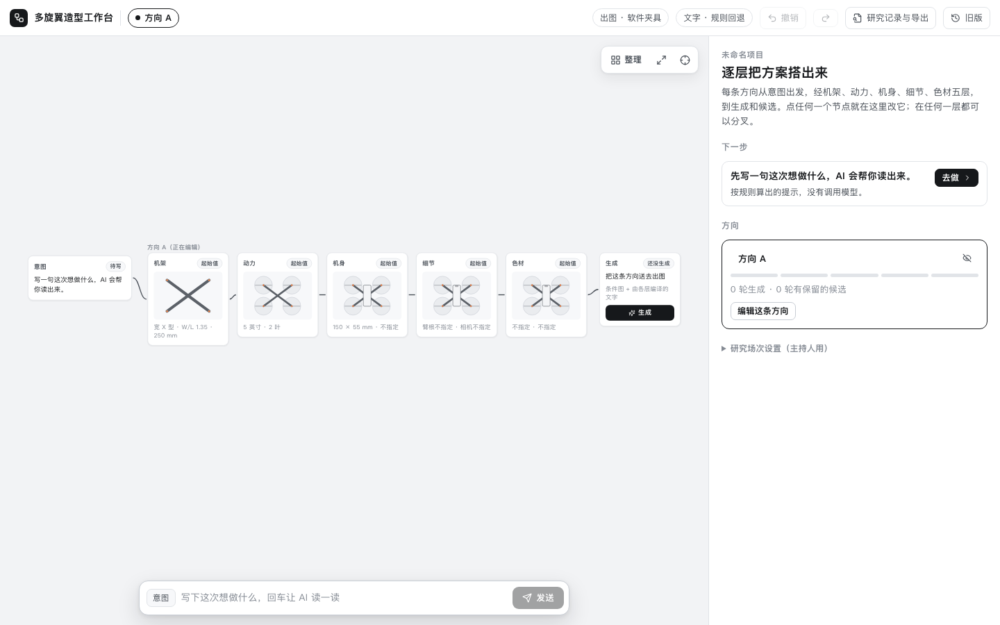
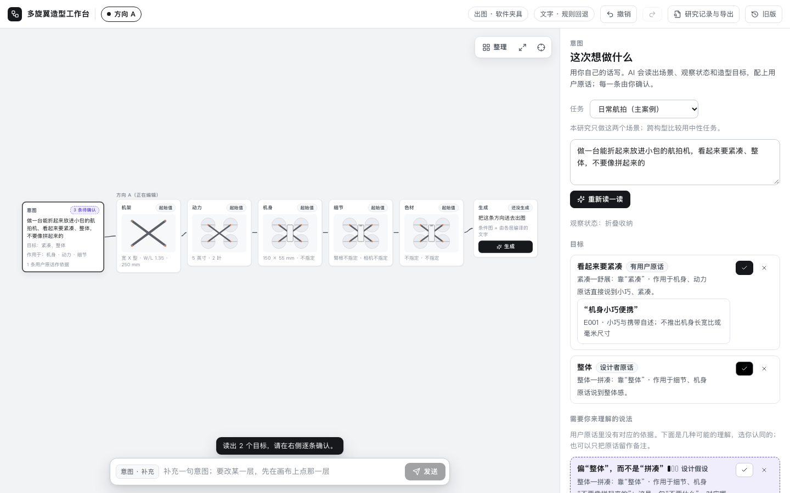
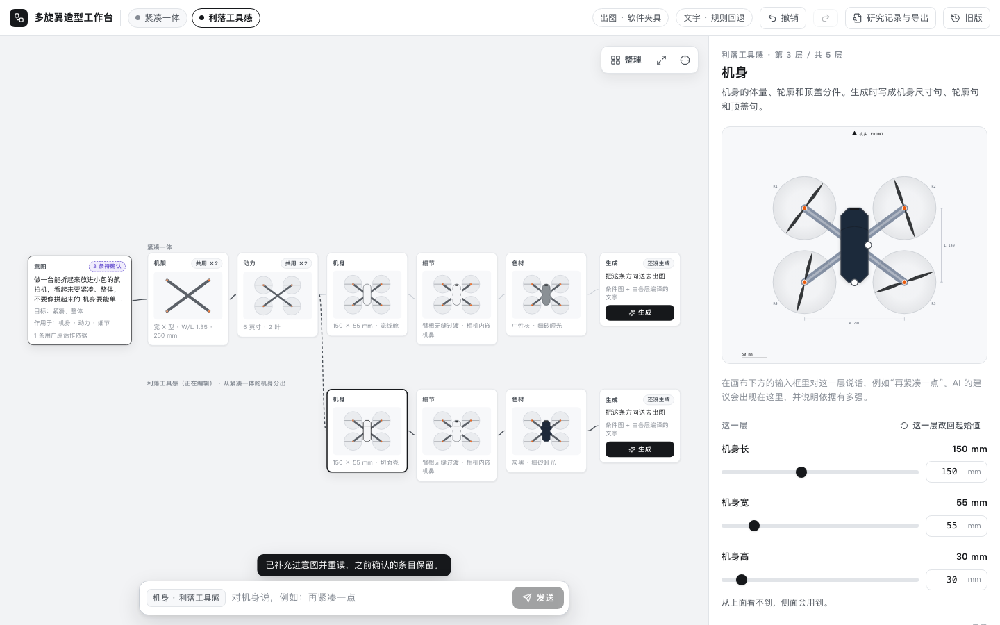
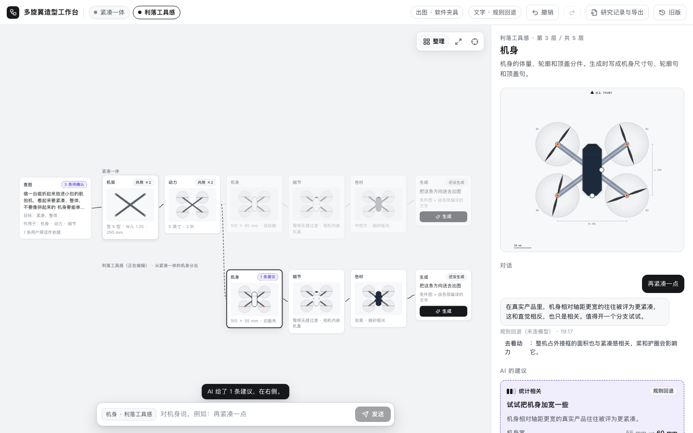
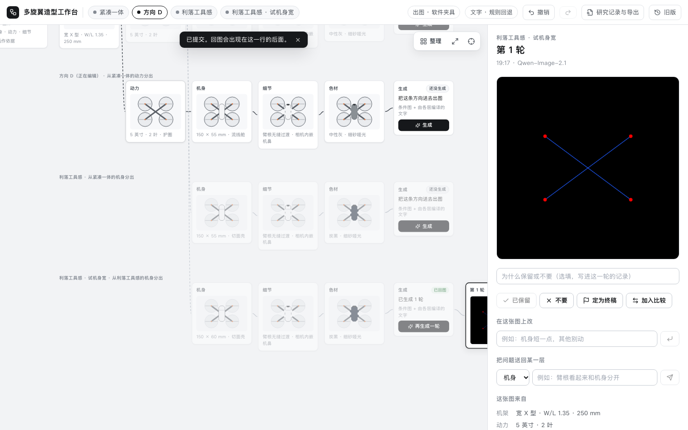
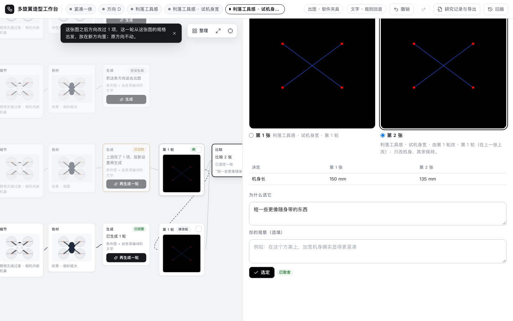
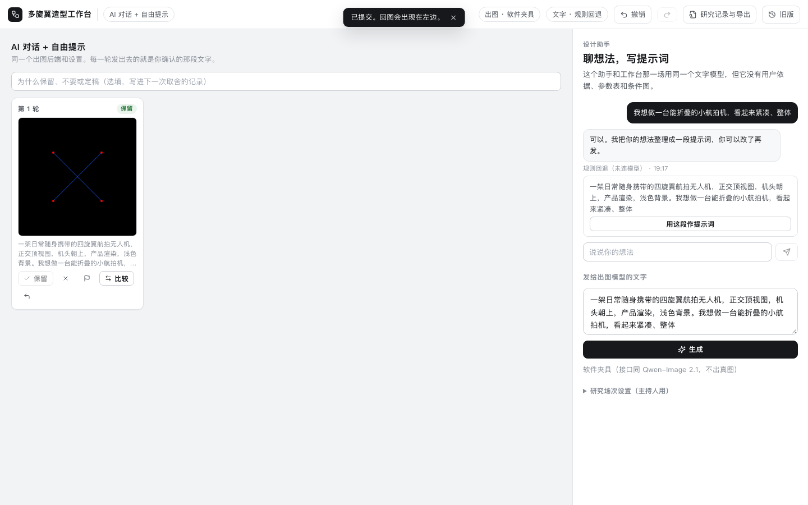
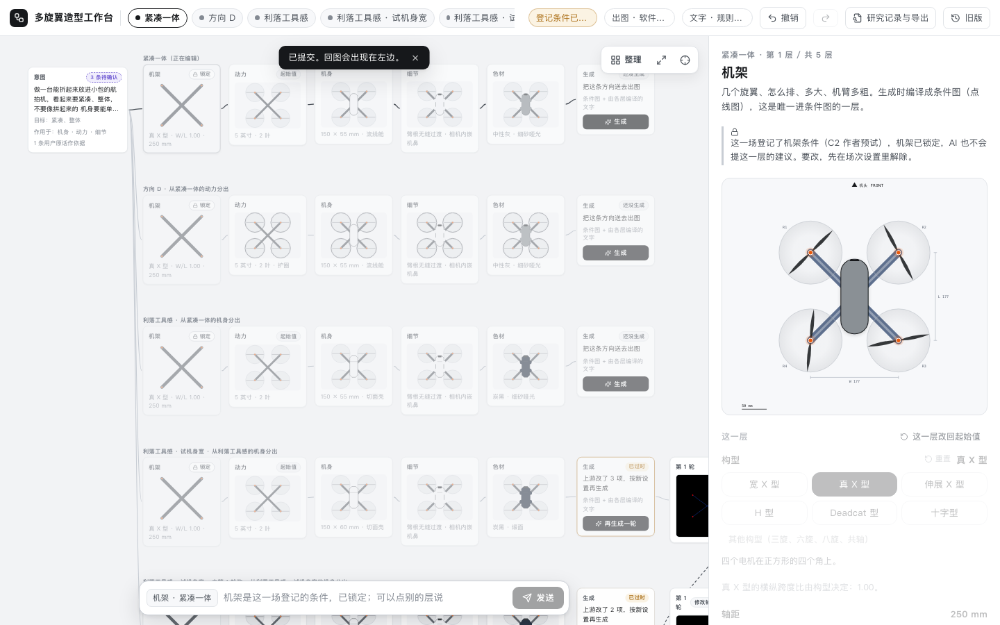

# 工作台 4.1 复核记录（2026-11-22）

作者转来 Codex 对 4.0 的评审，另外要求：节点能单个拖动、有一键整理；色材选项太少，要能自己写。逐条的核对结论和处理在[评审汇总（定稿）](../../../../../planning/2026-11-22-workbench-4-review-summary.md)，这里写工作台改了什么、怎样核对的。

## 一、开工前对蓝图

| 写明什么 | 这一步 |
| --- | --- |
| 对应论证链的哪一环 | RQ3 的设计过程与记录（两组都用 AI 的对照）；RQ4 的范围（两个主案例、八旋一轮迁移）；⑨ 冻结系统版本 |
| 对象范围、人数、参数 | 工作台的交互和记录。本轮没有真人场次。登记的测量不变 |
| 交到论文哪一节 | 3.5 节、第 4 章外部设计者一节；文献部分交 2.6、3.3 |
| 范围由谁定 | 作者 11 月 22 日转来的评审和要求；没有新增测量，也没有新开研究任务 |

## 二、改了什么

| 改动 | 对应 |
| --- | --- |
| 节点可以单个拖动，位置存下；“整理”一键排回按链对齐的位置 | 作者要求 |
| 色板 14 色加自定义颜色；表面处理加高光、金属漆、细纹理；“补充文字”栏原样写进生成文字，AI 不改它 | 作者要求 |
| 分叉后面板跟到新方向的同一层 | 第 05 条 |
| 在旧候选上改：从那张图冻结时的规格出发，另开一条方向，只加这次的改动；原方向不动。提议卡先写明“这张图之后又改了几项” | 第 06 条 |
| Windows 上替换记录文件遇到占用时稍等再试；一轮等过 60 秒出现“重新取回”和“放弃这一轮” | 第 07 条 |
| 自由提示那一场也能打开研究记录，只列这一场的轮次 | 第 08 条 |
| 轮次按项目归属；新建项目后旧图不出现、不能当父图 | 第 09 条 |
| 文字模型的回执必须写明模型名且与锁定的一致；日志分开记请求的版本和服务报的版本 | 第 10 条 |
| 软件夹具冒充后端时标签写“不出真图” | 第 11 条 |
| 两种方式的保留、不要、定为终稿都能写理由；可以记“结束本场” | 第 12 条 |
| “导出本场材料”：一个 ZIP 装工作区记录、每一轮的冻结输入与回执和原图、这一场的 AI 调用，附清单和校验值 | 第 13 条 |
| 用途不在两个场景里时 AI 先问按哪一个做；意图面板有明示的任务选择 | 第 01 条 |
| 跨方向的修改轮也从父图连出；放弃的一轮在画布上写“上一轮未完成”；方向名太长时顶栏截断并悬停显示全名 | 核对中发现 |

版本 4.1.0。规格导出（config-v2）的格式没有改：自定义颜色本来就是合法的十六进制值，补充文字用的是已有的字段，新增的表面处理只是多了几个取值。

## 三、核对

| 核对 | 结果 |
| --- | --- |
| TypeScript 检查与构建 | 通过 |
| `node --test scripts/*.test.mjs` | 31 项通过。比 4.0 多 4 项：Windows 占用时重试、回执没写模型名时拒用并分开记版本、越界用途先问、ZIP 能按中央目录逐个读回且校验值与 Node 自带的 CRC32 一致 |
| `npm run verify` | 70 项通过 |
| `npm run walkthrough:studio4` | 通过，连跑多次全过。在 4.0 的流程上加了：拖动一个节点其余不动、位置存下、整理排回；在动力处分叉后马上点“环形护圈”，改动落在新方向；保留时写理由；生成后把表面处理改成缎面，再回旧图说“机身短一点，其他别动”，新一轮在新方向里、表面处理仍是细砂哑光、只改了机身长、原方向保留缎面；比较后定为终稿；自由提示那一场写理由、打开研究记录只列这一场的轮次；导出本场材料，ZIP 里 3 轮、候选原图、5 条 AI 调用都对得上、没有缺的调用编号；新建项目后旧图不出现；“光伏巡检”先问任务；顶栏写明软件夹具 |
| “放弃这一轮” | 用故意拖慢的夹具手动核：等到 100 秒出现“重新取回”和“放弃这一轮”，点放弃后这一轮记为“生成未完成”，生成按钮恢复；另一次在 80 秒内回图，恢复入口自动消失 |
| 3.6 的走查（`#v=3`） | `walkthrough:canvas`、`walkthrough:methods` 都通过，没有页面错误 |
| 离线包 | 重打 `configurator-offline.zip`；`npm run check-offline` 通过，含 4.0 从 `file://` 打开的那一段 |
| 交接清单 | `planning/workbench-handoff/manifest.json` 更新了校验值，`verify_checkout.py` 核对通过 |
| 连线偶尔画不出 | 走查连跑时约三次有一次画不出跨方向的修改轮连线。查 React Flow 源码：新节点刚量完尺寸、尺寸存进来之前又重算一次时，它会丢掉节点的连接点位置，而带回尺寸后它不再自己重量。改为每次渲染后把丢了连接点位置的节点重量一次。修之后连跑 7 次全过；修之前一批三次里失败一次，另一批 14 次没有复现，所以这个偶发问题是否已完全消失，还要靠以后的连跑继续看 |

真实模型调用 0，真人场次 0。

## 四、还没验证的

- 真实文字模型：要作者定服务和版本，再跑 `npm run ai:smoke`（5 次调用）。
- 真实 GPU 上的 Qwen 后端。
- Windows 上的重试只用模拟的占用测过，没有在 Windows 机器上跑过。
- 主持人登记工具还不能读入“本场材料”ZIP。

## 截图

| | |
| --- | --- |
|  打开：顶栏写明出图是软件夹具 |  意图与任务选择 |
|  两个方向，上游共用 |  机身的建议标“统计相关” |
|  候选：写理由后保留 |  旧图上的修改另开方向，比较只差机身长 |
|  自由提示那一场 |  载入 C2：每条方向的机架都锁定 |
