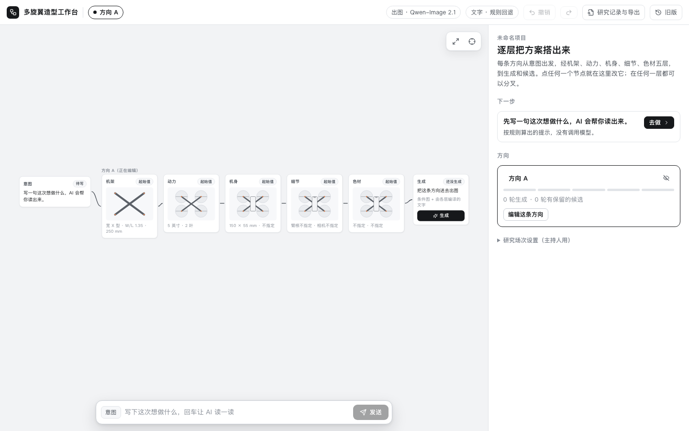
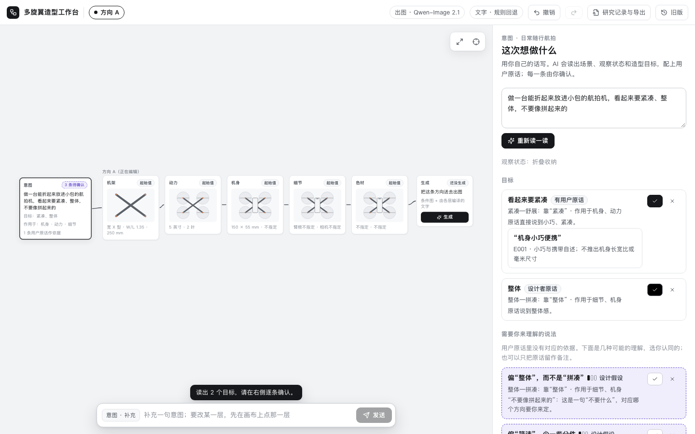
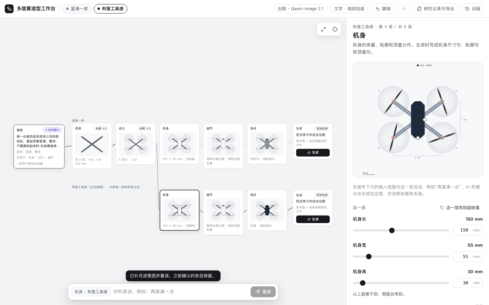
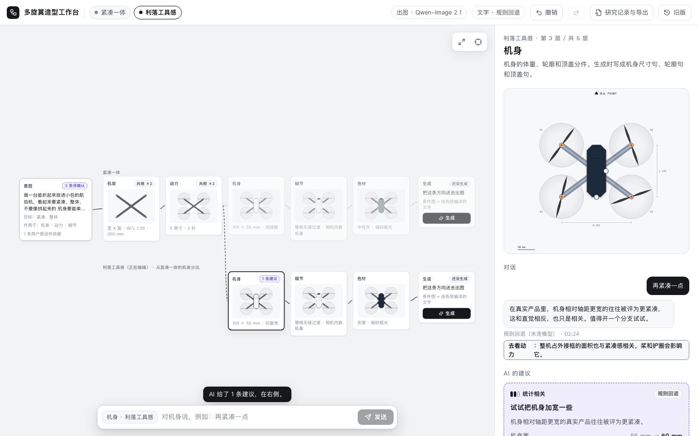
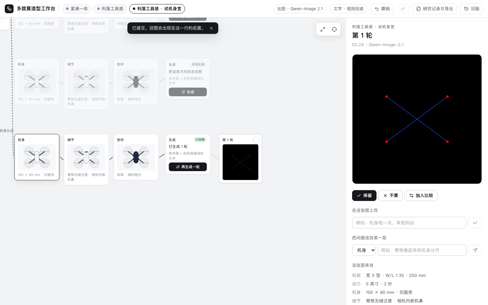
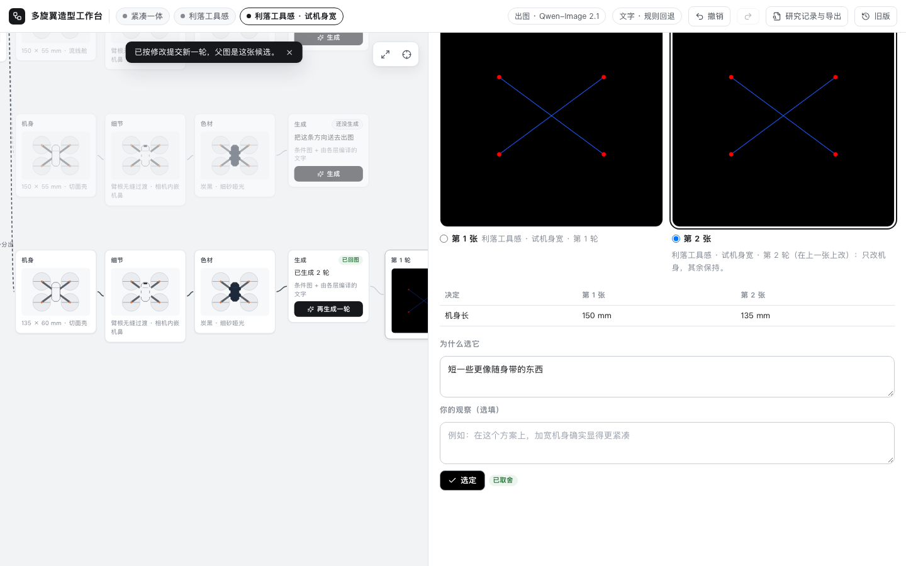
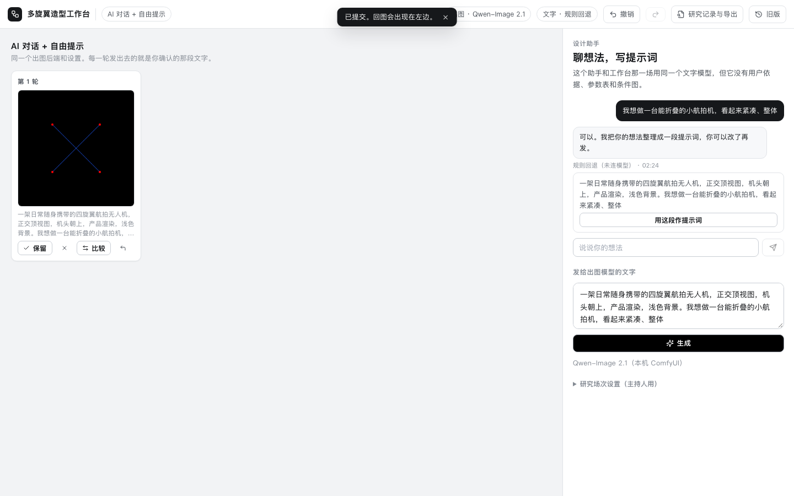
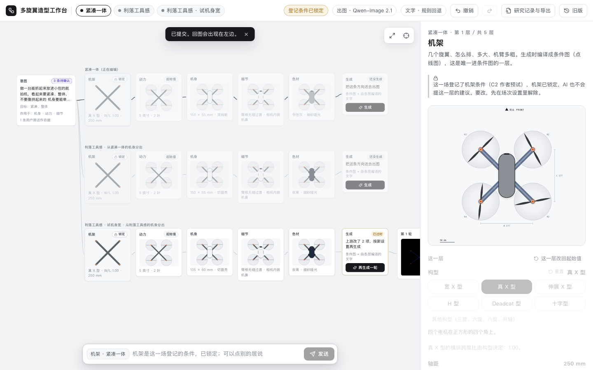

# 工作台 4.0 复核记录（2026-11-22）

作者试用 3.6 后要求重想整个交互，看过[提案第二稿](https://claude.ai/artifact/HvGGydakNZmo9bgtmLbyBD)后同意方向，并定了几条。本记录写这一版做了什么、核对了什么、还差什么。用法见[工作台说明](../../../../../prototypes/drone-configurator/README.md#40每条方向是一串设计决定默认打开)，设计理由见[界面设计说明](../../../../../prototypes/drone-configurator/interface-design.md)的 4.0 部分。

## 一、开工前对蓝图

| 写明什么 | 这一步 |
| --- | --- |
| 对应论证链的哪一环、哪个缺口 | 蓝图 ③ 的 RQ3（取舍、修订、接手）；⑨ 冻结系统版本。RQ3 的真人场次一场都没做 |
| 对象范围、人数、要对照的参数 | 工作台交互和 RQ3 的对照条件。本轮没有真人场次。登记的测量不变：主动操作时间、生成次数、合格率（两位盲态判读）、终稿质量（独立评议）、主观负荷短表 |
| 结果交到论文哪一节 | 3.5 节（协同生成与反馈）写 AI 在各步的角色；第 4 章“外部设计者两种方式”写两组条件；2.6 节的定位补一句（见第七节） |
| 范围由谁定 | 作者 11 月 22 日定：对照组也用 AI；文字模型走接口、不在本机部署；出图模型仍是固定的 Qwen；不做 AI 自动评图；不为功能完整加模块；先做好、作者试过再定是否预试 |

## 二、作者定的几条和这一版的回应

| 作者定的 | 这一版 |
| --- | --- |
| 对照组可以和 AI 对话、让 AI 改写提示词；比较两种人智协同方式，不是有没有 AI | “AI 对话 + 自由提示”成为一场：和同一个文字模型对话、起草提示词、生成、取舍。助手看不到证据和参数。每一轮记下发出的文字是自己写的、AI 起草原样用的还是改过的 |
| 重新核对研究问题和原方案，说清调整后能检验什么、影响哪些已完成的研究 | 写成带日期的修订，原文不改：[预试记录约定](../../../../../evidence/20261117-research-update/method/paired-pilot.md#2026-11-22-修订作者定两种方式都用同一个文字模型)、[登记任务表 C1](../../../../../planning/2026-11-17-direction-and-todo.md)、[蓝图 ② 和 RQ3](../../../../../planning/research-panorama/README.md)。结论见第七节 |
| 不在本机部署 Qwen 文字模型，用 MiniMax 或其他接口；两组同一版本，调用可记录、可追溯 | 文字模型经接口调用；版本锁定（回执里的模型名不一致就不用）；每次调用写一行 JSONL 日志；工作区记录里的每条建议连着调用编号。没有密钥时由规则回退应答并明说 |
| 暂不做 AI 自动评图 | 没有做。比较和取舍完全由设计者做 |
| 把意图理解、需求匹配、AI 辅助造型、画布交互、生成后的比较和迭代做好 | 见第三节 |
| 节点怎样分，从工业设计师的过程比较几种分法 | 比较了五种，采用逐层搭建：机架 → 动力 → 机身 → 细节 → 色材。机架和动力不合并：条件图只画机架，上一稿“一起生成条件图”的理由不成立。理由见[界面设计说明第二节](../../../../../prototypes/drone-configurator/interface-design.md) |
| AI 要分清已验证的规律、统计相关和设计假设，不要把未验证的结论变成规则，也不要机械地加警告 | 档位由证据登记决定，不由模型决定；表达靠措辞、三格标记和主按钮：只有已验证的建议主按钮是「照此修正」，其余两档是「开一个分支试试」 |
| 质量优先，作者充分试用后再定是否进入预试 | 没有冻结版本，也没有安排场次 |

## 三、改了什么

- **画布是决定链。** 每条方向一行：意图 → 五层 → 生成 → 候选与比较。每一层节点只管自己的决定，画累到这一层的顶视小图。在任何一层可以分叉；上游共用，共用的节点只画一次。改了上游，生成节点标“已过时”并列出改了哪几项。修改轮从父图连出。
- **AI 在每一步。** 读意图（目标、要设计者理解的说法、备注，配用户原话）；提方向（跨层的改动组，放上画布成为一条方向）；对某一层说话（变成这一层的参数建议，指出该去哪一层）；在候选上改（只动相关的层，其余记为保持不动）。
- **一条语言输入。** 画布下方的输入框跟着选中的节点走。意图写过以后再说一句是补充，已确认的条目保留。
- **AI 的提议先经服务核对。** 字段和取值合法、锁定的层不能改、引用的条目存在且与改动字段有关；不合格的拿掉并记进日志。
- **研究场次设置。** 方式（不限、工作台、AI 对话加自由提示）；载入并锁定 C2 登记条件（每条方向的机架锁定，控件变灰，输入框停用，AI 不提这一层的建议）；三样版本；导出工作区记录。
- **研究记录与导出。** 沿用 3.6 的研究详情页，看当前方向；新的一轮只从画布上的生成节点发出，详情页里不再能另起一轮。
- **视觉系统改为石墨。** 中性底色，颜色只表示意义：轴心橙、建议紫、需处理琥珀、通过绿。3.6 版和 4.0 共用一套颜色，所以 `#v=3` 里的墨绿也换成了石墨。
- **3.6 版保留在 `#v=3`。** 旧的复核地址仍打开 3.6；两边顶栏都能切到另一版。

## 四、核对

| 核对 | 结果 |
| --- | --- |
| TypeScript 检查与构建 | 通过 |
| 新代码的 lint | 0 个错误；1 条快速刷新的提示（Evidence.tsx 除组件外还导出了一个查卡函数） |
| `node --test scripts/*.test.mjs` | 27 项通过。其中决定链的逻辑 11 项（分叉、共用、只改这条方向、用另一条方向的这一层、过时、迁移），AI 服务 6 项（取值合法；不认识的字段、非法取值、锁定的层和不相干的引用被拿掉，档位由登记决定；版本锁定；规则回退也记日志；自由提示的助手不带证据和参数；粘贴进来的密钥和联系方式不发给模型） |
| `npm run verify` | 70 项通过 |
| `npm run walkthrough:studio4`（新） | 通过，见下面的截图。三条方向、三轮生成（结构化两轮、自由提示一轮）、5 次 AI 调用都在日志里，真实模型调用 0。核对了：补充意图不盖掉已确认的目标；机架两条方向共用只画一次；机身建议标“统计相关”、主按钮是开分支、引用 C-BWD；开分支后选中跟到新方向；修改轮父图正确、保持层写进记录；两张比较差 1 项决定并存下理由；自由提示发出的就是确认的原文，来源记为“AI 起草，原样使用”；载入登记条件后三条方向的机架都锁定、W/L 为 1.00；工作区记录里的建议连着日志里的调用编号；详情页没有另起一轮的表单；没有页面错误，没有本机以外的请求 |
| `npm run walkthrough:canvas`、`walkthrough:methods`（3.6，改为打开 `#v=3`） | 都通过，结果与上一版相同 |
| `npm run ai:smoke -- --fixture`（新） | 五种任务都通过；没有连真实模型 |
| 版本、离线包、交接清单 | 工作台 4.0.0；`configurator-offline.zip` 重打；`planning/workbench-handoff/manifest.json` 更新了五个文件的校验值，`verify_checkout.py` 核对 61 个文件通过 |
| 在内置浏览器里手动走一遍（1440 × 900 和窄屏） | 发现并改掉的问题：刷新后没有选中节点时，一句话会盖掉整段意图；默认视图缩得太小；面板里的顶视图高度为 0；面板内容比面板宽；三条方向时顶栏的状态被截断；锁定的机架控件看起来仍能改；候选名重复方向名；检查框点击误伤画布选中（走查脚本的问题，已改为用 Esc 回总览）。走查连跑时约五次有一次失败，查出是画布每次重算节点都丢了量好的尺寸，连线会短暂消失、偶尔不再出现；改为把尺寸带回去以后连跑 8 次全过 |

`npm run check-offline`：重打离线包后通过。新增一段 4.0 的离线检查：从 `file://` 打开时决定链照常画出，文字模型标“AI 未连接（离线打开）”，对输入框说话时提示要从本机工作台服务打开，写下的意图照样存下；没有报错，没有网络请求。

## 五、要作者的接口密钥和模型版本才能验的

- 真实文字模型是否守住输出格式、能否通过服务的核对、建议的质量和措辞是否按档位、每次要等多久。现在的检查全部用规则回退。
- 用哪个服务、哪个版本，由作者定，写进登记。默认填的是 `MiniMax-M3.1-Flash`，只是占位。
- 定下以后先跑 `npm run ai:smoke`（5 次调用），再在界面上走一遍。

## 六、要 GPU 才能验的

- Qwen 后端仍没有对真实 GPU 主机测过，和 3.6 相同。开机后先在画布上生成一张，核对回图是 1024 × 1024 的 PNG、请求里节点和权重文件名与主机一致、同一轮重交不产生第二次调用。

## 七、对已完成研究的影响

- **不受影响：** RQ1 的语料、36 张证据卡和词对；RQ2 的 E3、WLQ、A3、A8 及已归档请求；S5 第一步；RQ1′ 的意图评议；RQ4。它们都不经过工作台的文字模型，出图条件和读法不变。本分支没有改动任何实验数据和证据文件。S5 的相关结果和 A8 的管线读数成为证据登记里“统计相关”“已验证”两档的来源，内容不改。
- **要跟着改的（都还没开始）：**
  - 登记任务 C1 和预试记录约定：已写带日期的修订。
  - C4 的角色表：要多写一行，说明文字模型在两组里各做什么。
  - 主持人登记工具：还没有收存 AI 调用日志和工作区记录的命令，`seal` 也没有字段登记“文字由 AI 起草”。要在场次前定下收法，见[桥接工具说明末节](../../../../../planning/advisor-20261118/pilot-bridge/README.md)。
  - 蓝图白板（研究全貌图）上 ② 的那句还是“与自由提示相比”。仓库里的蓝图文字已加修订，白板本身还没改。
  - 论文的写法：3.5 节写 AI 在各步的角色；第 4 章写两组条件；2.6 节补一句：已有研究多是结构化界面对单纯文字提示，本文的对照组是 AI 对话辅助的提示。文献库里 Promptify（L063）一类“用大模型帮着探索提示词”的工具可作这一组的位置，引用具体结论前先核原页。Davis 等（L114）指出那项比较里两种界面背后的模型不同、作用分不开；本文两组用同一个出图模型和同一个文字模型，正是为了避开这一点。
  - “统一用 Qwen”从此只指出图模型。论文里写清楚文字模型是另一个，两组相同。

## 截图

| | |
| --- | --- |
|  默认打开 4.0：一条方向、五层，文字模型写明是规则回退 |  意图：两个目标、一句要设计者理解的说法，配用户原话 |
|  两个方向放上画布：机架、动力共用，从机身分开 |  对机身说“再紧凑一点”：建议标“统计相关”，主按钮是开分支 |
|  生成后的候选（夹具把条件图当回图） |  两张比较：差 1 项决定，选定并写理由 |
|  AI 对话加自由提示那一场 |  载入 C2 登记条件：三条方向的机架锁定 |
