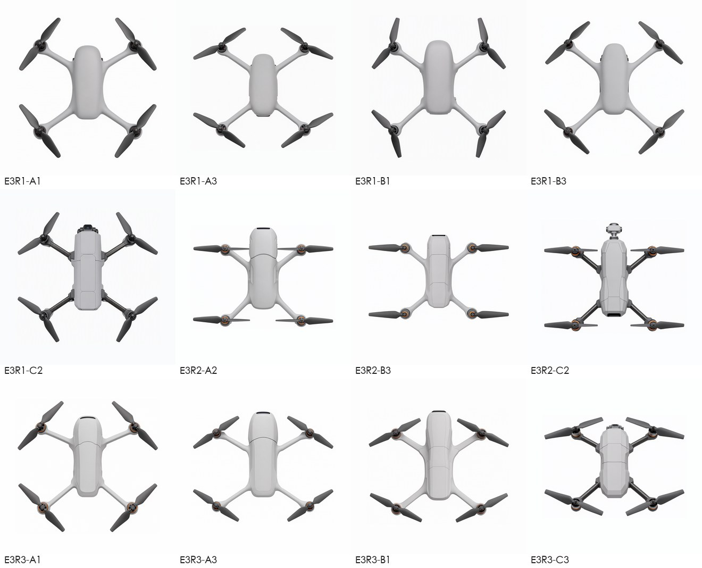

# 评议用图的审查与更换（2026-11-19）

**现行版本是 5.0，样本是多个品牌、多种构型的真实产品，见第十、十一节。** 下面先记录换图的经过。

作者看过 1.0 版评议包后指出：图是早期失败实验的图，完全没有无人机的视觉特征，是平的，相机还朝上，不能用。本页记录按什么标准审查、旧图为什么不合格、新图怎样做出来。1.0 版在发出之前撤回，没有任何人作答。

## 一、评议用图的标准

| # | 要求 | 为什么 |
| --- | --- | --- |
| 1 | 看上去是一件真实的消费级航拍四旋翼：有体积、有材质、有光影 | 评议者评的是对产品的印象，示意图得不到这个印象 |
| 2 | 部件合乎常理：四条臂连在机身上，四个电机，四副双叶桨；相机在机头、朝前，不朝上 | 不合常理的部件会把注意力引到“哪里不对”上 |
| 3 | 严格顶视，机头朝上，臂完全展开，浅色素背景，没有定位标记和文字 | 研究登记的观察条件是展开状态的顶视 |
| 4 | 同一组里颜色、材质、光照一致 | 避免颜色代替形态成为判断依据 |
| 5 | 要比较的两张图只差一个量，其余完全相同 | 否则说不清评议者是对哪个差别作出反应 |
| 6 | 每张图上这个量的实际大小是量得出来、有记录的 | 结论要落在量到的比例上，不落在“想要的”比例上 |

## 二、旧图（E1 条件图组）为什么不合格

| 标准 | E1 图的情况 | 结论 |
| --- | --- | --- |
| 1 产品感 | 平涂的灰色剪影，没有体积和光影，像图标 | 不合格 |
| 2 部件合理 | 相机画成一个正对观看者的镜头，等于朝上；臂是细直杆，靠近机身处有白缝，连不上 | 不合格 |
| 3 观察条件 | 顶视、素背景 | 合格 |
| 4 一致 | 不同种子的桨深浅差很多（r4 很浅） | 勉强 |
| 5 只差一个量 | 同一种子的不同档位之间机身形状也在变（r2 最明显） | 不合格 |
| 6 可量 | 比例由两名 AI 读者量过，12/12 命中 | 合格 |

E1 自己的说明页已经写明这批图“留作参数与方法比较”，正式评议用另外冻结的设计稿，并且指出它没有证明同一输出兼具几何响应和合格的产品造型。把它拿来做感知评议是我选材的错误：只看了第 6 条，没有按第 1、2、5 条审。

## 三至六、1.1 版的做法（已移进 archive）

> 2026-11-26：1.1 版的基准图出自 MiniMax H3 托管接口，没有发出，当天由第七节的 Qwen 1.2 版取代。原第三至六节按作者定移出 H3 冒烟数据，原文移到 [archive/experiments/s5-compactness-pilot/stimulus-review-v1.1.md](../../archive/experiments/s5-compactness-pilot/stimulus-review-v1.1.md)。第一节的标准不变。

## 七、统一到 Qwen：1.2 版的图（2026-11-19）

作者决定全文统一用一个模型（Qwen）。1.1 版因此没有发出，由 1.2 版取代（1.1 版的做法已移进 archive，见上）。

**基准图。** 第四章 E3 第三轮的四张 Qwen 原图：A1、A2、A3、B1（在本包里编号 Q1 到 Q4），没有新出图。B2 是作者选中的方案，不给预试的评议者看。B3 的桨离机身太近，桨加大或臂缩短后会与机身重叠，换成了 A2。

**第一次直接套用 1.1 版的脚本，不合格。** 短臂一档把机头挤尖，长臂一档把机头拉宽（[试验图](../../archive/experiments/s5-compactness-pilot/h3/qwen-edit-test.jpg)）。原因是这几个设计机身长、桨离机身近，臂也不是从中心沿对角线伸出的，而原脚本按“离中心多远”来划分哪里不动、哪里拉伸。

**改成分层的做法后合格。** [derive.py](../../archive/experiments/s5-compactness-pilot/h3/derive.py) 现在先把图分成机身和四个组件（臂、电机、桨）：机身一层逐像素不动；每个组件沿臂根到电机的方向按比例位移，臂根不动，电机和桨整体移动；桨叶可再绕电机中心缩放。三档轴距是电机到中心距离的 0.87、1.00、1.13 倍，三档桨径是 0.8、1.0、1.2 倍。

**逐条核对。** 标准 1 到 4：四个设计都是合格的产品渲染，四臂四桨，机头有相机舱，顶视白底，同为浅灰机身深灰桨。标准 5：同一个设计的五张图出自同一张原图，机身不变。标准 6：改动量给定并逐图记录在 [qwen/derive.json](../../archive/experiments/s5-compactness-pilot/qwen/derive.json)；脚本对每张图检查桨与机身重叠的像素数（全部为 0）和离画面边缘的最小距离（最少 22 像素），不满足就报错。

过程中发现并改掉的两个毛病：桨尖颜色浅，起初没被算进组件，缩小桨之后在原处留下残片；加边的做法会在图里留下一圈浅色边框，已去掉。

核对是我逐张看图加程序检查做的，没有第二个人看过。

## 八、2.0 版：第一部分换成 12 个不同的设计（2026-11-19）

作者打开 1.2 版后说图“完全一样，看不出差别”。核对后确认图是不同的，但他说得对：第一部分把同一个设计的五个版本一次一张地放出来，臂长只差 13%，桨的版本之间只有 1% 到 4% 的像素不同，人不可能逐张评出差别。这是设计上的错，不是图的问题。作者同时指出，现在还没到设计实验的阶段，先要弄清人把什么样的机子看成紧凑，用什么图都可以，真实照片也行。

**真实照片没有找到够用的。** 在自由许可的图库里按十几组关键词检索，返回的几乎都是无人机拍的航拍照，不是拍无人机的照片，随后被限流。此前那一轮找图的结论相同：正顶视、展开、整机完整的真实照片很少。

**改用自己的设计候选。** 第四章 E3 三轮共 27 张 Qwen 候选图，是合格的产品渲染，布局和机身差别明显。取其中 12 个（三轮、三个方向都有，不含作者选中的第三轮 B2），统一占幅后作第一部分。同一个模型、同一套配色，颜色和品牌不干扰判断；范围比真实产品窄，这一点写在方案的限度里。

**第二部分只留差别大的。** 每个因素只比最低档和最高档，并排呈现，共 8 组正题加 3 组核对题。所有图统一占幅。

走查 28 项通过。只有我看过这些图。

## 九、3.0 版：改用真实产品（2026-11-19）

作者看了 2.0 版后指出路走错了：文献里做感知评议用的都是真实产品样本，我们用模型生成的图顶替不对；找不到图就该用浏览器直接去厂商那里找，而不是去免费图库。这个批评成立。2.0 版用自己的设计候选顶替，是我在第一次检索不顺时降低了标准。

**怎么找的。** 用内置浏览器打开 DJI 官方商城的产品页，发现页面的 3D 展示用的是官方模型文件。逐个产品页读取页面数据，得到 13 个展开状态的模型；用模型内部的名称和机型代号核对各是哪一款。新出的小机型（Neo、Neo 2、Flip、Mini 5 Pro、Lito）和 Mavic 4 Pro 的商城页、官网页都没有 3D 模型。

**为什么用模型渲染而不是找照片。** 真实照片很难凑齐同一视角：各家拍摄角度、光照、背景都不同。官方模型就是产品本身的几何和材质，用同一机位渲染，11 款的视角、光照、画幅完全一致，比照片更符合“统一刺激”的要求。

**逐条核对。**

| 要求 | 情况 |
| --- | --- |
| 真实产品 | 11 款都是 DJI 在售或在售过的机型，模型来自官方商城 |
| 部件合乎常理 | 是产品本身的几何：臂、电机、桨、云台相机都在 |
| 严格顶视、机头朝上、白底 | 正上方渲染，视场 8 度；Avata 2 和 Inspire 3 原始朝向相反，已转 180 度 |
| 颜色、光照一致 | 同一环境光；统一去色 |
| 画幅一致 | 整机外接框长边统一占画面 80% |
| 来源可查 | 模型地址、文件摘要、渲染参数记在 real/samples.json |

13 个模型里没用的两个：DJI FPV 的另一种配色，和与 Mavic 3 Pro、Mavic 3 Classic 外形相同的 Mavic 3。

**页面也改了。** 只留单图评分，去掉成对比较：现在的问题是真实产品里哪些显得紧凑，对照是下一步。评分时图固定在量表旁边（手机上固定在上方），不会滚出屏幕。

走查 27 项通过。只有我看过这些图。

## 十、4.0 版：多品牌、多类型，靠检索图片（2026-11-19）

作者看了 3.0 版后指出三点：样本全是 DJI 一个类型，应当尽量覆盖不同的品类；不必非要拿到模型文件，关键是去搜图；要认真做，保证多样和真实。3.0 版确实又钻进了一种取法：发现 DJI 商城有 3D 模型，就只做了 DJI。

**做法。** 先列出 54 个机型检索词，覆盖折叠航拍、全包护圈、小型固定臂、经典固定臂、穿越机、涵道穿越机、行业机、专业影视机和几款异形机；用图片检索逐个查顶视图，两轮共 648 张候选。逐张看缩略图挑出真顶视的，下载原图 88 张，再逐张看大图筛选。

**筛的时候发现的问题。**

- 检索结果里混着 AI 生成的假图，例如机背上长着屏幕或遥控器的“无人机”。来源页不是厂商或销售商的，一律不取。
- 第三方 3D 模型站和游戏社区的自制模型看着像产品图，不是厂商的图，不取。
- 不少顶视图的桨是转动的虚影，或者整机被画面裁掉一部分，不取。
- 有些图里机体只有两三百像素，放大后发虚，不取。Autel EVO Nano+、EVO Lite+、Mavic Air 2、Mavic 2 Pro 因此没进。
- 白底上的白色机身抠图后太淡（Phantom 4 Pro），或者留下一块阴影（Mavic Mini），不取。

**结果。** 32 款，18 个品牌，十种类型；30 款来自检索到的产品图，2 款（DJI Avata 2、DJI FPV）检索不到够清楚的顶视图，用官方 3D 模型渲染。3.0 版里那些 DJI 官方模型的渲染，凡是检索到了同机型产品图的，都换成了检索到的图。

走查 27 项通过。筛图是我一个人做的。

## 十一、5.0 版：补上四旋翼以外的多旋翼（2026-11-19）

作者指出研究对象已经是多旋翼，4.0 版收的却全是四旋翼。4.0 版只收四旋翼是我自己定的，蓝图里没有这样说：论文题目是多旋翼，第五章是跨构型应用，RQ4 问的是换了构型还成立多少，而这一问在感知上一点数据都没有。

**做法同前。** 又检索两轮，36 个检索词、432 张候选，覆盖六旋翼、八旋翼、共轴、双旋翼和三旋翼，下载原图 42 张，看大图筛选。

**结果。** 新增 12 款：六旋翼 8 款（DJI Matrice 600 Pro、DJI S900、Yuneec H520、Yuneec Tornado H920、DJI Agras T30、Hylio AG-216、Inspired Flight IF1200、Aurelia X6），八旋翼 3 款（DJI Agras MG-1、Freefly Alta 8、Skyfront Perimeter 8），共轴 1 款（DJI Agras T50）。全套现在是 44 款、22 个品牌。

**没有收到的。** 三旋翼和双旋翼几乎没有成品机型的顶视图，检索到的多是自制机架的桌面照片或论文插图；DJI FlyCart 30、Freefly Alta X、XAG V40 这些共轴或双旋翼机型能找到的顶视图里机体只有几十到两百像素；Tarot 机架图没有装桨；JJRC H20 找到的是底面。这些都没收。

**读的时候要注意。** 六旋翼和八旋翼几乎都是行业机、农业机和专业影视机，和消费级航拍四旋翼比，用途和旋翼数是混在一起的。构型之间的差别只作探索性描述。

走查 27 项通过。筛图是我一个人做的。

