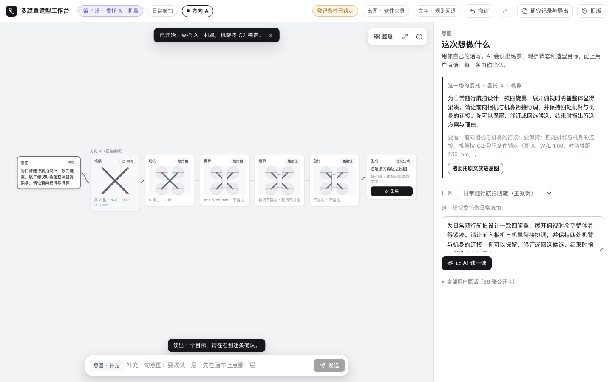
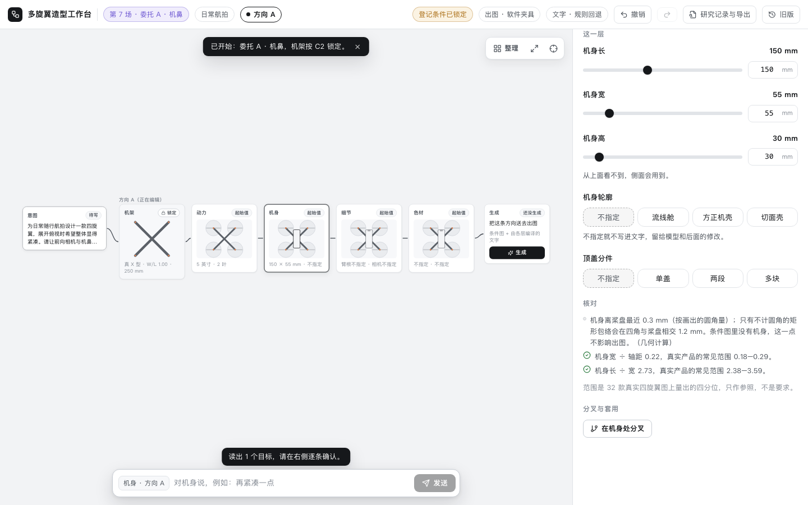
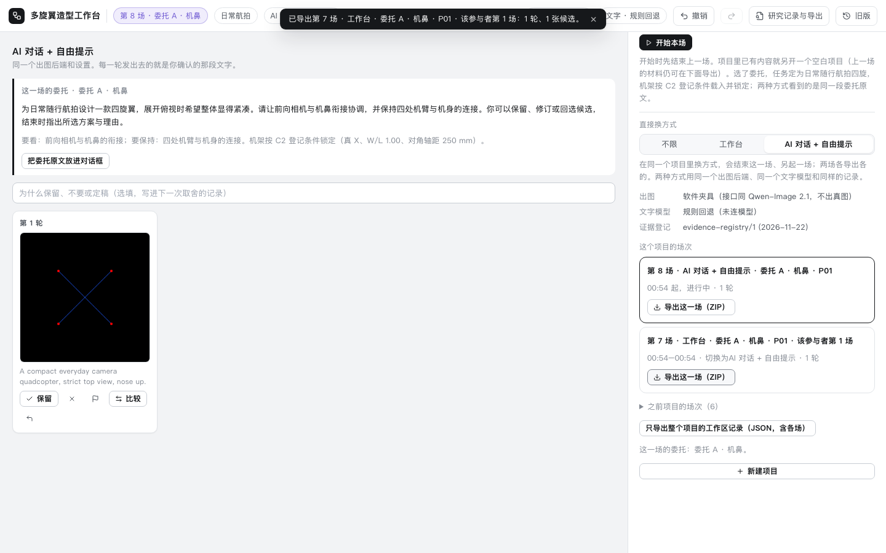
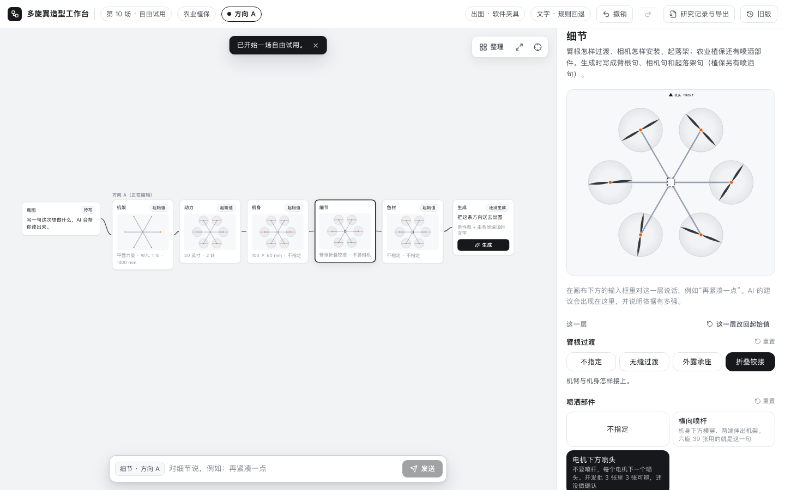
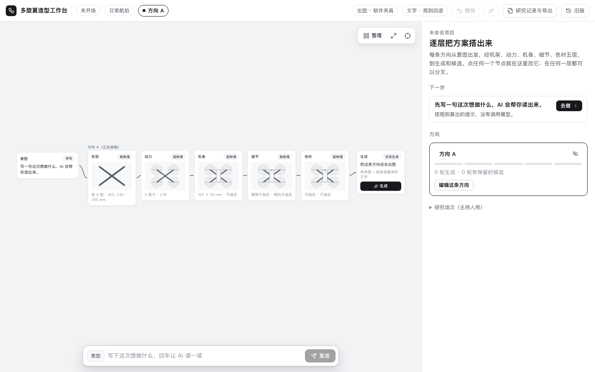
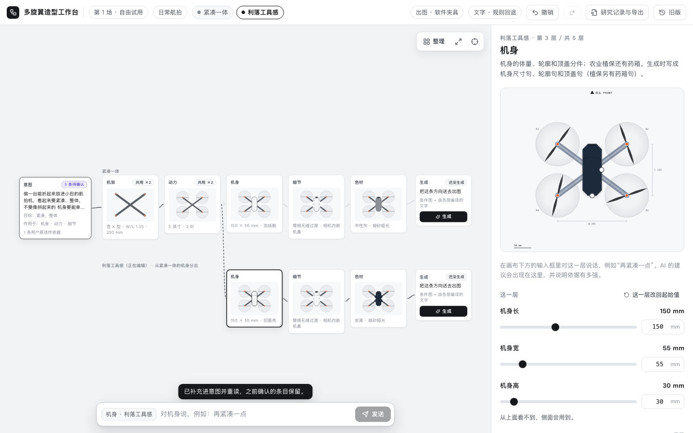
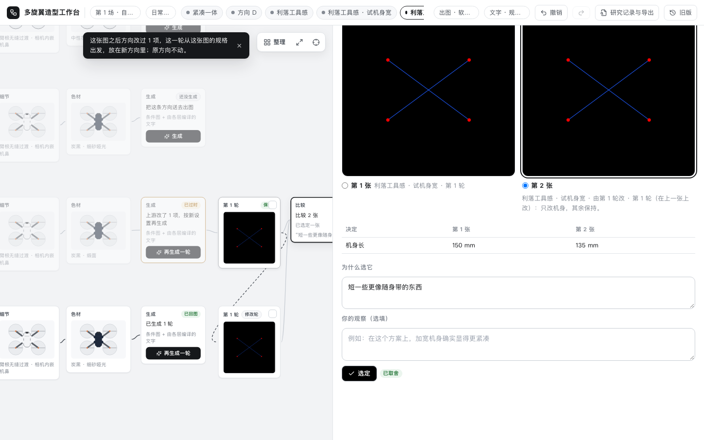
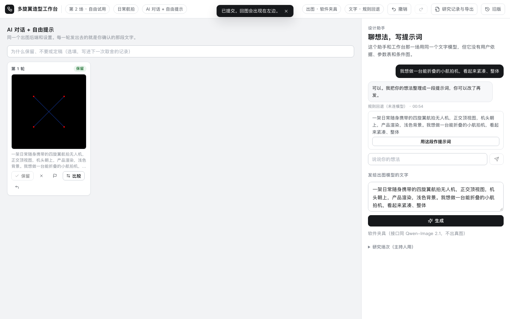

# 工作台 4.2 复核记录（2026-11-23）

作者 11 月 23 日要求对照蓝图和论文的实际研究再核一遍工作台，并提了四点：起始任务按主实验来；本场材料按实际场次分开；植保六旋加药箱和喷洒部件；判断 C2 的重叠会不会影响出图。另定文字模型统一用 MiniMax M3.1。逐条的核对结论在[工作台与研究主线的对齐](../../../../planning/2026-11-23-workbench-alignment.md)。这里写工作台改了什么、怎样核对的。

## 一、开工前对蓝图

| 写明什么 | 这一步 |
| --- | --- |
| 对应论证链的哪一环 | RQ3 的两种方式对照（C1、C2 的登记条件）；RQ4 的范围；H2 植保案例；⑨ 冻结系统版本 |
| 对象范围、人数、参数 | 工作台的交互和记录。本轮没有真人场次。登记的测量、C2 机架三项、每场 15 分钟、9 次机会、9 张图都不变 |
| 交到论文哪一节 | 3.5 节；第 4 章外部设计者一节；5.5 节 |
| 范围由谁定 | 作者 11 月 23 日的四点和文字模型的决定；没有新增测量 |

## 二、改了什么

| 改动 | 对应 |
| --- | --- |
| 主持人在“研究场次”里开一场：委托（A 机鼻、B 臂根或不用）、方式、参与者编号、该参与者第几场。选了委托：项目里已有内容就另开空白项目，任务定为日常随行航拍四旋，机架按 C2 载入并锁定，委托原文在意图面板和自由提示两边都显示；“把委托原文放进意图／对话框”由设计者自己点，点了记一笔 | 作者第 1 点 |
| 工作台只做两个任务：日常随行航拍四旋（主案例）、农业植保六旋（场景适配案例）。机架层只给本任务的构型（四旋的几种排法；植保只有平面六旋），注明八旋、共轴等迁移检验走 GPU 请求管线。3.6 版和请求管线保留全部构型 | 作者第 1 点 |
| 场次：每一场记编号、方式、委托、参与者、次序、起止和结束原因；每一轮、每条事件、对话、建议、方向、比较都写下场次编号。在同一个项目里换方式、开始本场、新建项目，都另起一场；一场结束时它的记录存进本机存档 | 作者第 2 点 |
| “导出这一场”：ZIP 只装这一场的轮次、原图、回执、事件、对话、建议和 AI 调用；文件名写场次号、方式和委托；轮次文件名照界面的叫法；清单自检“每一轮都属于这一场、都是这一场的方式”；自由提示的一场不附工作台的方向和节点。研究记录抽屉也只列这一场的轮次；自由提示那一场只显示这一场的轮次和对话 | 作者第 2 点 |
| 植保：机身层加“药箱”（半嵌入方形箱；收进机身），细节层加“喷洒部件”（横向喷杆；电机下方喷头）。英文句子用已出过图的请求原文，选项旁写明出过多少图。起始值对齐 39 张：双叶桨、折叠铰接、半嵌入药箱、横向喷杆。选电机下方喷头时提示顶视常被挡、按方法章记“不可判” | 作者第 3 点 |
| 机身间距按示意图画出的外形量（圆角或倒角，示意图和核对共用一份定义）。只在矩形包络的尖角上相交时，显示灰色说明“条件图里没有机身，这一点不影响出图”；真放不下仍报警告 | 作者第 4 点 |
| 文字模型锁定 `MiniMax-M3.1-Flash`（MiniMax 官方接口里 M3.1 的名字）。每条调用日志和界面标签写明发到哪个服务（主机名）。冒烟检查改用登记的委托 A 和锁定的 C2 机架 | 作者定的文字模型 |
| 已经有决定或生成时换任务，先确认，再另开项目；AI 读出的任务和现在的不同时只问、不换；模型读出“中性外观比较”时保持原任务 | 核对中发现：4.1 会把四旋的决定套在六旋的起始值上 |
| 工作台每生成一轮记一条事件；读意图的事件带调用编号（从底部输入框读意图时，4.1 的导出会漏掉这次调用） | 核对中发现 |

版本 4.2.0。规格导出（config-v2）只多了两个可选字段（药箱、喷洒部件），只出现在植保的规格里；四旋的规格和旧文件的导入都不变。

## 三、核对

| 核对 | 结果 |
| --- | --- |
| TypeScript 检查与构建 | 通过 |
| `node --test scripts/*.test.mjs` | 39 项通过，比 4.1 多 8 项（见对齐页第四节） |
| `npm run verify` | 71 项通过 |
| `npm run walkthrough:studio4` | 通过。前后跑了 10 次，没有一次失败；其中最后 2 次在最终代码上。新的一场从空的撤销历史开始（撤销撤不掉登记的锁定）也在走查里。新增：同一个项目里“工作台 → 自由提示 → 回到工作台”的三个 ZIP 各自只有自己的轮次和 AI 调用；一条方向跨两场时，第二场 ZIP 里的“第 2 轮”与画布叫法一致；按委托开一场（另开项目、C2 锁定、委托原文、任务不能换）；C2 的机身核对是灰色说明；换成自由提示后委托沿用、次序不沿用，两场各导各的；植保的药箱、喷洒选项与冻结文字里的原句；有决定时换任务要确认并另开项目 |
| 3.6 的走查（`#v=3`） | `walkthrough:canvas`、`walkthrough:methods` 通过，没有页面错误 |
| `npm run ai:smoke -- --fixture` | 5 项通过（规则回退） |
| 离线包、交接清单 | 重打 `configurator-offline.zip`，`check-offline` 通过；`verify_checkout.py` 核对 61 个文件通过 |
| 代码检查 | 改动涉及的目录 0 个错误、1 个旧警告；全库另有 15 个错误在没动过的旧文件里 |
| 手动 | 在内置浏览器里按委托 A 开一场、生成、换成自由提示再生成，导出两场：工作台那一场只有“方向 A第1轮”和 1 次读意图的调用，自由提示那一场只有“自由提示第1轮”；按钮的选中状态 50 毫秒内就跟上了存下的值 |

真实模型调用 0，真人场次 0。

## 四、还没验证的

- 真实文字模型：作者已定 M3.1，冒烟（5 次调用）要作者同意用哪把密钥。服务若把模型名报成 `MiniMax-M3.1-Flash-Preview`，锁定会拒用，届时由作者定登记哪个名字。
- 真实 GPU 上的 Qwen 后端；“药箱收进机身”没出过图。
- 两组共用的“用户依据摘要”还没有定稿文本，现在两边只显示委托原文。
- 主持人登记工具还不能读入本场 ZIP。

## 截图

| | |
| --- | --- |
|  按委托 A 开一场：C2 锁定，委托原文在意图面板 |  C2 下机身核对：灰色说明，不影响出图 |
|  换成自由提示是第 8 场，只有自己的一轮；场次列表各导各的 |  植保六旋：药箱与喷洒部件 |
|  打开 |  两个方向，上游共用 |
|  旧图上的修改另开方向 |  自由提示那一场 |
