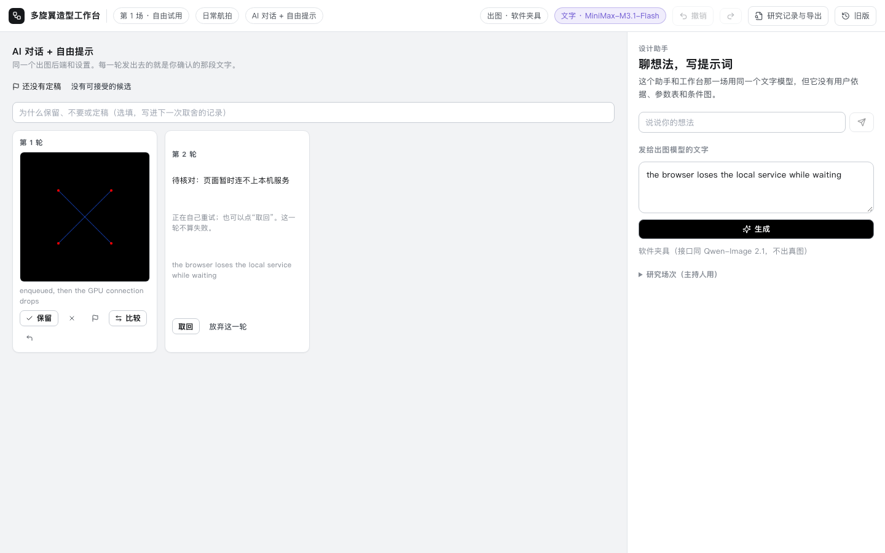
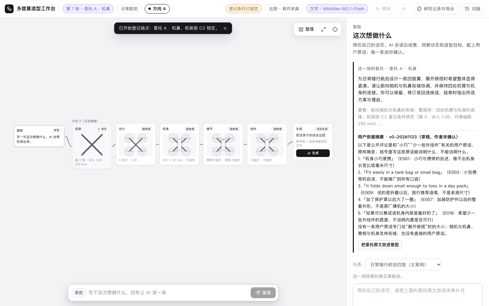
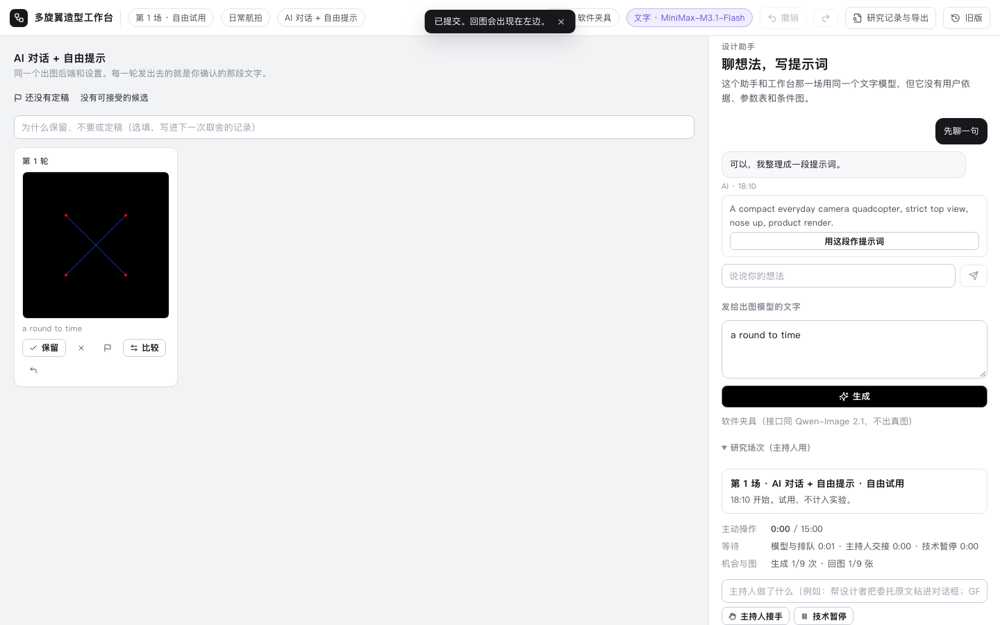
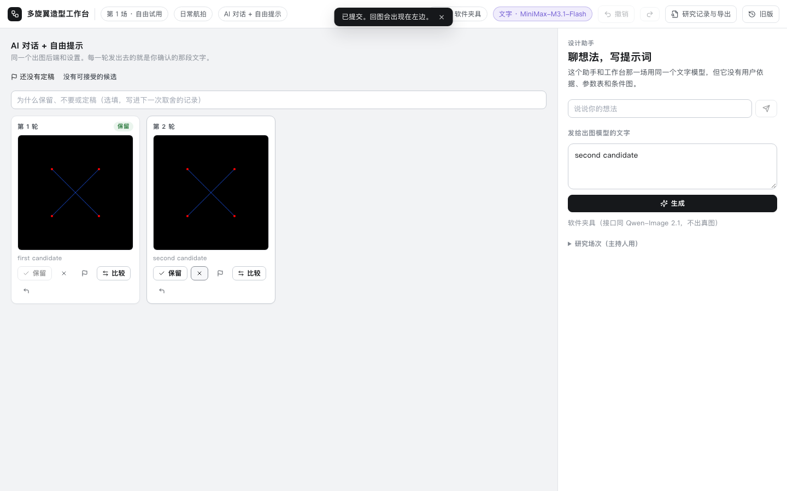
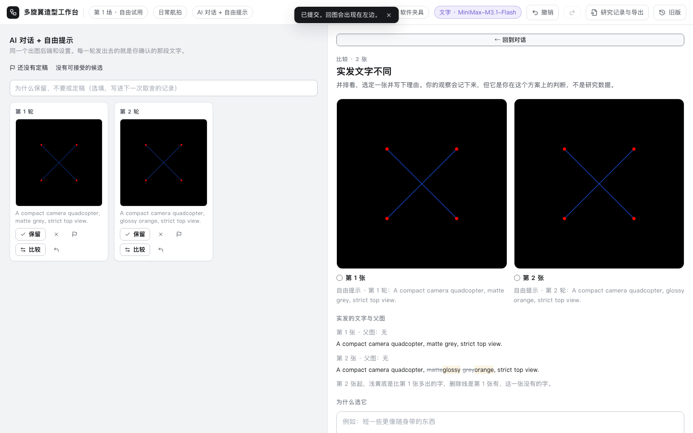
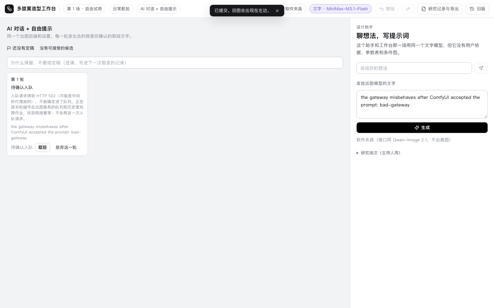
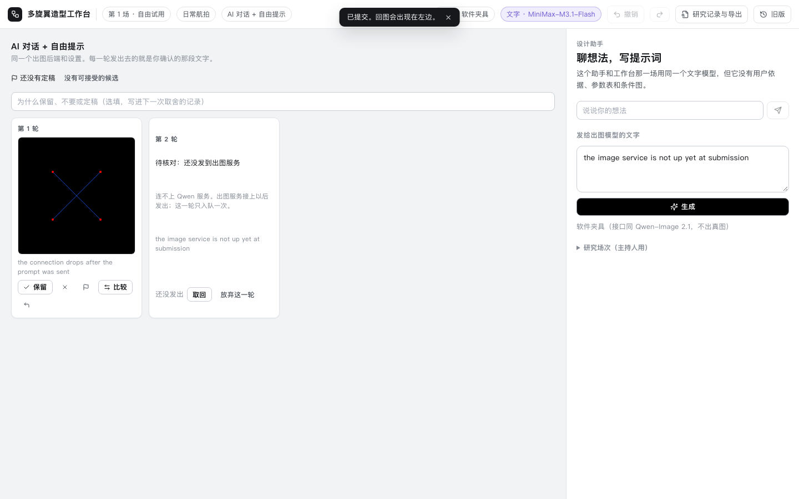

# 工作台 4.3 复核记录（2026-11-23）：Codex 盲测 14 条，GPT 复测 3 条（4.3.1）

> 2026-11-26：4.5 起出图只接 Qwen，文中提到的开发用 MiniMax 出图后端已去掉（见 [4.5 复核记录](../20261126-workbench-4.5/README.md)）。以下原文保留不改。

作者 11 月 23 日把 Codex 对 4.2（PR #97，`fabdbcf`）的盲测结果交来，要我以自己的测试为准，判断哪些属实、哪些我没遇到，然后把现有问题全部修好；要 GPU 的部分等修完以后作者租机器。这一页逐条写：Codex 说了什么，我在 4.2 上复现到了什么，4.3 怎样改，在 4.3 上怎样验收。

结论先写在前面：**能在本机测的 12 条，我在 4.2 上全部复现了，没有一条是误报**；4.3 上这 12 条都通过了同一套检查。第 7、14 条要真实 GPU，已写好验收脚本并在夹具上演练通过。第 4 条的修改要用真实密钥再验一次；第 8 条的摘要文字要作者定稿。

同日稍晚，作者又转来 GPT 对 4.3 的复测三条（入队回执丢失时可能入队两次；远端收下后 502 或回执断开被记失败；入队没确认就写“已入队”）。三条我在 4.3 上都复现了，4.3.1 修好，见[第六节](#六431gpt-复测三条)。第二节第 3 条里“确实不在才重新入队”的做法就是 GPT 指出的问题，4.3.1 起不再重发。

## 一、开工前对蓝图

| 写明什么 | 这一步 |
| --- | --- |
| 对应论证链的哪一环 | RQ3 两种方式对照的登记条件（C1、C2）：两组同一个文字模型版本、同一套出图设置、每场 15 分钟主动操作、至多 9 次机会、9 张图、同一套记录；预试记录约定“主持与计时”和 research-library/design/pilot.md 第 2、3 条（计时分类、场次事件表）；⑨ 冻结系统版本 |
| 对象范围、人数、参数 | 工作台的场次记录、出图恢复、计时和导出。本轮没有真人场次，没有真实模型调用（文字和出图都由软件夹具应答）。登记的测量、C2 机架三项和三项限额都不变 |
| 交到论文哪一节 | 3.5 节（系统实现与记录）；第 4 章外部设计者一节（场次材料怎样收存）；5.5 节（局限：真机验收前的状态） |
| 范围由谁定 | 作者 11 月 23 日：按 Codex 盲测逐条判断并修。没有新增测量；第 14 条的前后对照表是按登记的“非目标部位漂移”拟的草案，作者同意后再用 |

## 二、逐条

复现用的是新写的 `scripts/studio4-issues.mjs`（`npm run walkthrough:issues`）：起一个本机服务，文字模型和 ComfyUI 都换成可控的夹具，可以按住回答、报错、按 MiniMax 文档的规则截断，可以在入队后断线、让服务“重启”、按缺权重报 HTTP 400。同一份脚本先在 4.2 上跑（12 条全不过），再在 4.3 上跑（12 条全过）。

| 条 | Codex 说的 | 我在 4.2 上复现到的 | 4.3 的修改 | 4.3 上的结果 |
| --- | --- | --- | --- | --- |
| 1 高 | 换参与者开新的一场，上一场没发的文字和父图仍被发出 | 属实。P01 没发出的对话、提示词和选中的父图都留在 P02 的页面上；P02 写了自己的文字再生成，实际请求里仍带着 P01 的那张父图 | 每到场次的分界（一场结束、主持人开新的一场）界面上的草稿都重来：对话框、提示词、父图、比较里选的图。出图前再核一次父图：自由提示只能用这一场的候选，工作台只能用这个项目的 | P02 的页面是空的；实际请求只有 P02 自己的文字，0 张图 |
| 2 高 | 晚到的 AI 回答记进了下一场 | 属实。自由提示的回答晚到，记进了后面的工作台那一场；工作台读意图的回答晚到，被用进了下一场的项目（多出 1 个目标），这次调用进了第三场的 ZIP，发出它的那一场 ZIP 里一条也没有 | 每次 AI 调用发出时记下场次，回答、失败、晚到都记回那一场；晚到的不用在现在的界面上（不改意图、不显示建议和方向），在那一场记一条“晚到，没有用上”，并补进那一场结束时的存档。一场结束时还没处理的建议和方向记为“这一场结束时未处理” | 三场的 ZIP 各自只有自己的调用和对话；晚到的读意图记在发出它的工作台那一场，项目没有被改 |
| 3 高 | Qwen 已入队，断线后取不回 | 属实，三种情况都复现了：入队后服务到 ComfyUI 断线，远端已经跑完，工作台却记失败；页面到本机服务断开，自由提示那一页只写“需要恢复”，没有按钮，一直停着；本机服务重启，回执记为失败。三种情况都只入队了一次（这一点 4.2 是对的） | 入队以后连不上、等超时、服务重启都不算失败，记成“待核对”，带着 prompt_id，接上以后按原作业取回；只有 ComfyUI 明确拒收或报运行失败才记失败。入队回执丢了时先在 ComfyUI 的队列和历史里按本轮编号找，找到就接着等，确实不在才重新入队（prompt_id 由工作台给定）。远端已经找不到这一轮（GPU 主机重启）时不自动重入队，等人决定。两种方式都有“取回”和“放弃这一轮”；放弃不算远端失败 | 三种情况都取回了原图，每轮只入队一次；自由提示那一页有“取回” |
| 4 高 | M3.1 读意图在 max 下被截断（4096、放宽到 8192 都截断） | 属实，原因从 MiniMax 文档找到了：M3.1-Flash 不写推理强度时就是 max；思考也算进输出上限，上限不够就以 length 收尾、回答为空。4.2 写的是 `max_tokens: 4096`，回执里也不记推理强度和收尾原因。我没有用真实密钥调用（还没得到你同意），用按文档规则应答的夹具复现了：五个入口全部截断 | 改用文档建议的 `max_completion_tokens: 131072`（文档上限 524288），推理强度写明 `max`（和服务的默认一致，回执里看得到）；等待上限从 90 秒放宽到 300 秒（页面等 330 秒）。每条调用日志写下请求的设置、服务报的模型名、收尾原因、用量和推理内容；截断时报“输出达到上限”并记下用了多少 | 夹具上五个入口都完整，回执写明 M3.1-Flash、max、stop。真实调用还要验一次，见第四节 |
| 5 高 | 失败的文字调用不进 ZIP | 属实。服务日志里有两条失败，ZIP 里 0 条，清单写“引用 0、缺失 0” | 浏览器每次调用记一条 ai-call（入口、发出和回答的时间、调用编号、失败原因）；服务把场次编号写进日志，导出时按编号和场次一起取回。请求没到服务的失败单列；找不到的编号列为缺失 | 两条失败都在 ZIP 里，带编号、入口、时间和原因；清单写“失败 2” |
| 6 高 | 重新导出旧场次，清单写的是现在的模型 | 属实。换了服务配置、刷新页面后重导旧场次，清单写的是新配置（另一个文字模型、MiniMax 出图），逐轮记录写的是 Qwen | 开场时把出图后端、文字模型、推理强度和版本记进场次；清单写这一份（4.3 以前的旧场次从这一场的调用和轮次回执推出，并写明）。导出这一刻的配置单列为 exportedWith，只作对照；自检“环境与回执一致” | 清单写 M3.1-Flash 和 Qwen-Image-2.1，与回执一致；导出时的配置另列 |
| 7 高 · 要真机 | 4.2 → AutoDL 还没有一次完整的真机验收 | 属实（还没做过） | 写好 `npm run gpu:acceptance -- --comfy-url <地址>`：两种方式各出首图和两次修订，逐轮核对原图、输入图数、工作流、权重、采样设置、种子、prompt_id、运行历史、入队次数、事件表，并和本场 ZIP 对上 | 在夹具上演练通过（6 轮全过）。真机等作者租好机器 |
| 8 高 · 要定稿 | 两组共用的用户依据摘要还没定 | 属实 | 委托卡片下面加“用户依据摘要”，两种方式是同一个组件、同一个版本；版本和摘要（SHA-256）开场时记进场次，导出时写进清单。我按登记的主题表挑了一份 v0 草稿（E001、E003、E009、E007、E016 的原话和限制，见 `src/design/defaults.ts`），界面和清单都写明“草稿，作者未确认” | 两边显示同一版本，场次记录里有版本。文字要作者定 |
| 9 高 · 预试前 | 主动时间、等待、主持人操作还没分开核对 | 属实。没有交接的记法，没有分开的计时，没有事件表 | 场次面板加“主持人接手”“技术暂停”和“交回/恢复”（写一句做了什么）；顶栏写明进行中。计时按登记的口径分开：主动操作、模型与排队等待、主持人交接、技术暂停、未知等待；本场结束时还没回图的轮次记未知等待，主动操作只给上下限、不补数。按登记的场次事件表（列名一字不差）导出每个时间点，写明是页面、本机服务、GPU 主机还是主持人的钟；取不到的留空写原因。登记场次第 10 次生成不再发出 | 交接、等待、主动操作分开算出；事件表与登记的空表同列 |
| 10 中 | 定稿后“不要”，终稿含糊 | 属实。两次“定为终稿”的事件都留着，清单和界面都没有当前终稿 | 一场只有一个当前终稿：后定的替换先定的；当前终稿被“不要”或撤下，就写明没有定稿，不退回更早的那张；可以登记“没有可接受的候选”（pilot.md 第 2 条）。经过全部留在事件里，清单写当前值和经过 | 清单写“没有定稿”，经过三条；界面写“还没有定稿” |
| 11 中 | Qwen 原始回执散在本机；入队失败的具体错误丢了 | 属实。ZIP 里没有服务端原件；HTTP 400 只写“返回 HTTP 400” | 每一轮附上服务端原件（实发请求、实发文字、入队回执、运行历史、拒收时的原始回答、作业记录）；和已装的候选原图、条件图、父图字节相同的不再重复装，清单注明是哪一个；缺的列出来。拒收时写出 ComfyUI 报的节点、原因和权重文件名 | 两轮的原件齐全；拒收的那一轮写明“节点 1 UNETLoader：Value not in list：unet_name …” |
| 12 中 | “直接换方式”开出缺次序的登记场次 | 属实。换出来的仍标登记场次，次序为空 | 委托、方式、匿名编号、次序四项齐全才算登记场次；登记场次里“直接换方式”是灰的。pilot.md 第 2 条要求同一个人两场用不同的委托和方式，所以下一场由主持人结束本场后在“开一场”里开；表单按上一场填好第 2 场（另一份委托、另一种方式），同人同委托、同方式、同次序时提醒 | 换方式按钮是灰的；所有登记场次四项齐全 |
| 13 中 | 自由提示的比较页看不出实发文字的差别 | 属实。标题写“决定相同，只差在生成本身”，页面上没有发出的文字 | 比较页列出每一张实发的文字和有没有父图（是哪一轮），第 2 张起按词标出多出和删掉的字；标题按实际记录写：差在几项决定、实发文字不同、父图不同，或输入完全相同 | 标题“实发文字不同”，两段文字和父图都在 |
| 14 中 · 要真机 | 局部修改是否改对部位、保住其他部位 | 要真机，本机判断不了 | 真机验收同时出两组修订前后的原图（只改机鼻、只改臂根），匿名编号，按登记的读者表逐张读；另附一张前后对照表草案（目标部位改没改、保持的部位漂没漂、不可判的原因、图里的尺寸文字），作者同意后再发给读者 | 演练产出了 6 张匿名图、读者表和对照表草案 |

## 三、核对

| 核对 | 结果 |
| --- | --- |
| `npm run walkthrough:issues`（新） | 4.2 上 12 条全不过；4.3 上 12 条全过 |
| `node --test scripts/*.test.mjs` | 43 项通过（新增：推理强度与输出上限、截断与回执、按场次取回调用；Qwen 断线、回执丢失、服务重启、拒收、远端丢失；计时与事件表；终稿与登记场次的完整性） |
| `npm run verify` | 71 项通过 |
| `npm run walkthrough:studio4` | 通过；第 15 步改为：登记场次里换方式是灰的，结束后表单按上一场填好第 2 场（委托 B、自由提示、P01、第 2 场），两场各导各的 |
| `walkthrough:canvas`、`walkthrough:methods`（3.6） | 通过，没有页面错误 |
| `npm run ai:smoke -- --fixture` | 5 项通过；表里多了服务报的模型、推理强度和收尾原因 |
| `npm run gpu:acceptance`（夹具演练） | 6 轮全过，产出匿名盲读材料 |
| 代码检查 | 改动涉及的文件 0 个错误，1 个旧警告 |

真实模型调用 0 次，真人场次 0 场。

## 四、还没验证的，和要作者定的

1. **文字模型的真实调用（第 4 条）。** 要用你的 MiniMax 密钥跑一次 `npm run ai:smoke`（5 次调用，推理强度 max）。要看：服务报的模型名是不是 `MiniMax-M3.1-Flash`（文档里也出现过 `-Preview`）、五个入口是否都以 stop 收尾、每次花多久。max 下一次读意图可能要等几十秒到几分钟，这部分时间按“模型等待”计，不吃 15 分钟；如果太慢，推理强度可以统一降一档，但两组必须同一档，并写进登记。
2. **真机验收（第 7、14 条）。** 见第五节。
3. **用户依据摘要的文字（第 8 条）。** v0 草稿挑了五条原话：E001“机身小巧便携”、E003 小包、E009 折叠后、E007 加了保护罩以后大了一圈、E016 希望集成进机身。草稿末尾照实写了：没有一条原话专门说“展开俯视”时的大小，相机与机鼻、臂根与机身的衔接也没有直接的原话。选哪几条、怎样措辞由你定；定了以后把状态改成“已确认”。
4. **等待时还在操作算不算主动时间（第 9 条）。** 现在的规则是：有一轮在等图或一次 AI 调用在等回答，这段按等待计，不算主动操作；设计者在等待时做了几件事另外报出（eventsDuringWaiting）。这样两组的 15 分钟都不被出图快慢吃掉。如果你认为等待时的操作应计入主动时间，告诉我改口径。
5. **第 14 条的前后对照表。** 草案，按跨构型协议登记的“非目标部位漂移”拟的；你同意后再发给读者。

## 五、真机验收怎么跑

1. 在 AutoDL 上开一台能跑 Qwen-Image 2.1 的机器，装好 ComfyUI 和三份权重（与 E3 归档同名：`qwen_image_2.1_bf16.safetensors`、`qwen3vl_8b_bf16.safetensors`、`qwen_image_2.1_vae_bf16.safetensors`；不同名时用环境变量 `QWEN_UNET`、`QWEN_CLIP`、`QWEN_VAE` 指定，报告里照实写）。
2. 让本机能连到 ComfyUI：AutoDL 的自定义服务地址，或 SSH 隧道把远端端口转到本机。
3. 本机执行：`npm run build`，再 `npm run gpu:acceptance -- --comfy-url <地址> --out <输出目录>`。默认文字模型用规则回退；要连真实文字模型加 `--text-model`（密钥只从环境变量读）。
4. 看 `<输出目录>/report.md`：6 轮（两组各首图、只改机鼻、只改臂根）逐轮写明输入图数、1024×1024 原图、种子、prompt_id、排队和执行时间、是否通过；两场的 ZIP 在 `zips/`；盲读材料在 `local-edit/`（`reader/` 发给读者，`pairs-researcher-only.csv` 只给主持人）。
5. 真机跑完以后再用 `npm run studio:chat -- --image-backend qwen-comfy --comfy-url <地址>` 手动试一场，并试一次断网后“取回”。

## 六、4.3.1：GPT 复测三条

作者同日转来 GPT 对 4.3（`ea4f0f9`）的复测，要我实际查这三条还在不在，在就修，不在就在 PR 里回复。**三条都在。** GPT 附的复现日志在 Codex 那台机器上（`D:\codex\tmp\…`），我打不开；下面的复现都是我自己做的：一个真正走网络的 ComfyUI 冒充服务（Node 的 fetch 按真实网络情况报错），加上浏览器里的三条走查（`walkthrough:issues` 的 G1–G3）。没有调用真实模型。

| 写明什么 | 这一步 |
| --- | --- |
| 对应论证链的哪一环 | 同第一节：RQ3 两种方式对照的登记条件（每轮的记录、入队次数、计时口径）；⑨ 冻结系统版本（4.3.1） |
| 对象范围、人数、参数 | 只动出图作业的入队与取回、页面上的状态文字、事件表里“入队”一行的缺失原因。没有真人场次，没有真实模型调用；登记的测量和限额不变 |
| 交到论文哪一节 | 3.5 节（系统实现与记录） |
| 范围由谁定 | 作者：查这三条，在的就修 |

| 条 | GPT 说的 | 我在 4.3 上复现到的 | 4.3.1 的修改 | 4.3.1 上的结果 |
| --- | --- | --- | --- | --- |
| 1 高 | 入队回执丢了以后，同一轮可能入队两次 | 属实。入队请求送到 ComfyUI，远端还在校验时连接断了；这时队列和历史里都还没有这一轮，4.3 查一次没找到就重发，服务收到 2 次请求。点“取回”时马上发生；不点的话，远端校验超过 3 秒也会发生。远端始终没有这一轮时，4.3 也在 3 秒后重发 | 请求发出后没收到完整回执，就不再发第二次：记“待确认入队”，只按本轮编号（prompt_id、client_id）在 ComfyUI 的队列和历史里找，找到就接着等、取回原图。发出 2 分钟后仍然找不到，停下来等人决定（点“取回”再找一次，或者放弃这一轮），不自动重发。发出前先存盘，服务进程在等回执时停了也照这样处理 | 服务只收到 1 次请求；远端校验完以后找到原作业，取回原图。远端始终没有这一轮的，过了时限（测试里调短）停下等人，点“取回”也只是再找一次 |
| 2 高 | 远端已经收下，工作台却把这一轮记为失败 | 属实，两种都复现了：中间的代理在 ComfyUI 收下以后回 502，4.3 记“Qwen 服务拒收了这一轮（HTTP 502）”；回执的响应头到了、正文传到一半断了，4.3 记“处理 Qwen 回执时出错”。远端照样跑完，接上以后也取不回 | 只有 4xx（工作流校验没过、缺权重等）算明确拒收，记失败，保留 ComfyUI 的原始回答。5xx、408、200 却没有作业号、正文没收完，都算“进没进队列不知道”：记待确认入队，按本轮编号去找；代理的原文另存为 `comfy-enqueue-reply.txt`。读进度、读队列、取图时正文断了，也只算暂时不知道。ComfyUI 回了作业号就算已入队。运行失败仍记失败，保留运行历史 | 502 和正文断开的两轮都取回了原图，各入队 1 次；明确拒收和运行失败照旧记失败，保留具体回执 |
| 3 中 | 入队还没确认，页面就写“已入队” | 属实。入队请求发出后连接断了，服务端记的是“入队结果不明、作业号为空”，页面却写“待核对：已入队，等出图服务接上”。服务没开、请求根本没发出时，页面同样写“已入队”，入队请求还记成 2 次（实际送到 1 次） | 页面按服务端记的入队状态写：结果不明写“待确认入队”；连接根本没建立写“待核对：还没发到出图服务”（只有这种情况接上以后照常发出，不计入入队请求数）；收到回执或在远端找到原作业以后才写“已入队”。服务端再查的那几秒仍按待核对显示。发出前先看一眼 ComfyUI 的队列接口，服务没开就确定没有发出 | 两种情况都没出现“已入队”；没发出的那一轮接上以后发出，入队请求记 1 次 |

顺带改正的一处：回执丢了、后来在队列或历史里找到的轮次，4.3 把“找到的时间”记成了入队时间。4.3.1 只记找到的时间（`foundAt`），事件表里“入队”一行留空，写明“没有收到入队回执；某时在 ComfyUI 的队列里按本轮编号找到原作业，入队时间不知道”。

**核对**

| 核对 | 结果 |
| --- | --- |
| 新增单元测试（走网络的 ComfyUI 冒充服务，6 项） | 4.3 上 5 项不过（校验中丢回执、502、正文断开、远端始终没有、发出前连不上），1 项通过（明确拒收和运行失败）；4.3.1 上 6 项全过 |
| `walkthrough:issues` 新增 G1–G3（浏览器） | 4.3 上 3 条全不过；4.3.1 上 3 条全过 |
| `walkthrough:issues` 全部 | 4.3.1 上 15 条全过（Codex 的 12 条，GPT 的 3 条） |
| `node --test scripts/*.test.mjs` | 50 项通过 |
| `npm run verify` | 71 项通过 |
| `walkthrough:studio4`、`walkthrough:methods`、`walkthrough:canvas` | 通过，没有页面错误 |
| `npm run check-offline`（离线包按 4.3.1 重打） | 通过 |
| `npm run ai:smoke -- --fixture` | 5 项通过 |
| `npm run gpu:acceptance`（夹具演练） | 6 轮全过，每轮入队 1 次，没有发现问题 |
| 代码检查 | 改动涉及的文件 0 个问题（全库另有 22 个旧问题，都在这次没动的文件里） |

真实模型调用 0 次，真人场次 0 场。

**还没验证的：** 真实 ComfyUI 和 AutoDL 的代理在这些情况下实际怎样应答（服务没开时代理回不回 502、正文断开时报什么），要等真机。第五节的验收脚本照常用；它要求每轮入队 1 次，回执丢失、后来找到的轮次事件表里“入队”一行是空的，报告会把它列为问题，这是照实写，不是失败。

## 截图

| | |
| --- | --- |
|  页面连不上本机服务：这一轮“待核对”，自由提示那一页也有“取回”和“放弃这一轮” |  委托下面是两组共用的用户依据摘要（v0 草稿，写明作者未确认） |
|  场次面板：主动操作、等待、交接分开计，对照 15 分钟、9 次、9 张；主持人接手、技术暂停 |  当前终稿被“不要”以后，写明“还没有定稿” |
|  自由提示的比较：实发文字的差别和父图 |  4.3.1：远端收下后代理回 502，这一轮写“待确认入队”，不记失败 |
|  4.3.1：出图服务没开，入队请求没有发出，写“还没发到出图服务” | |
