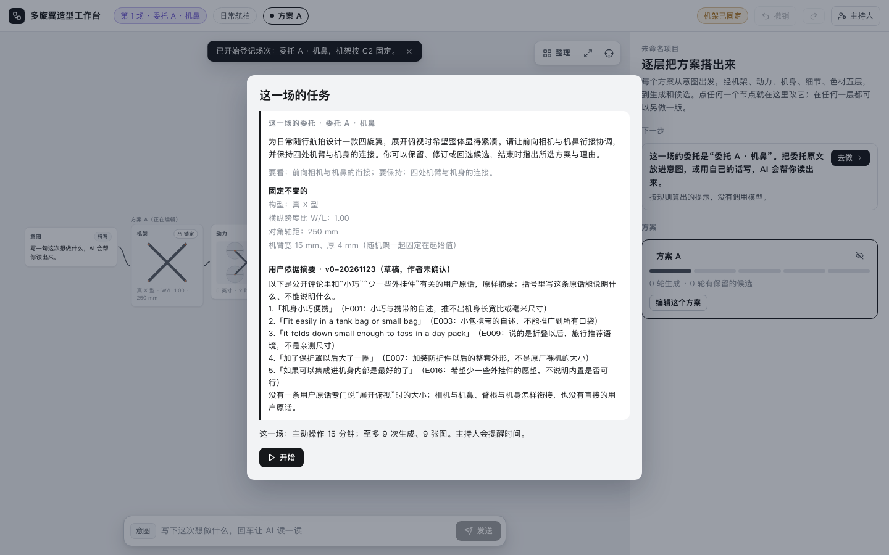
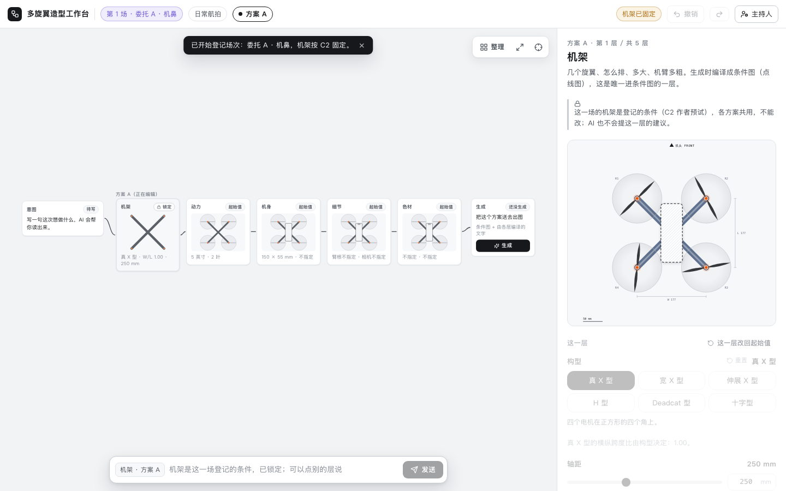
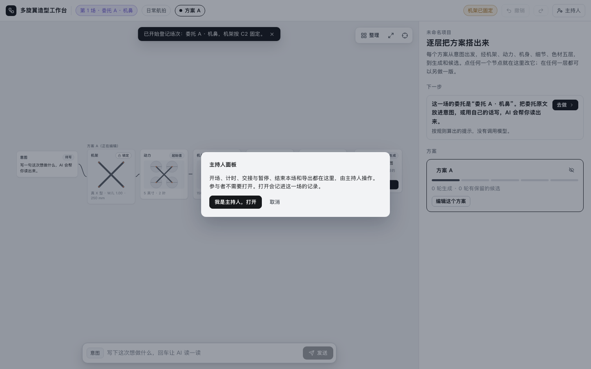
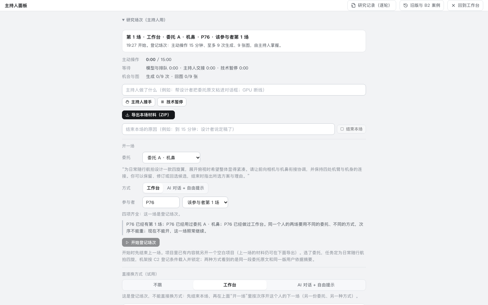
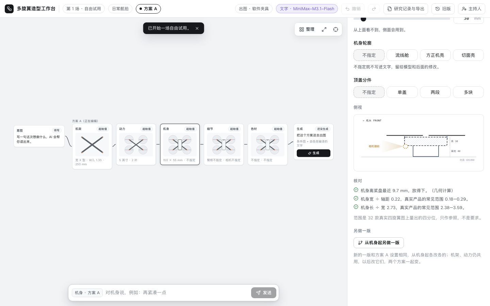
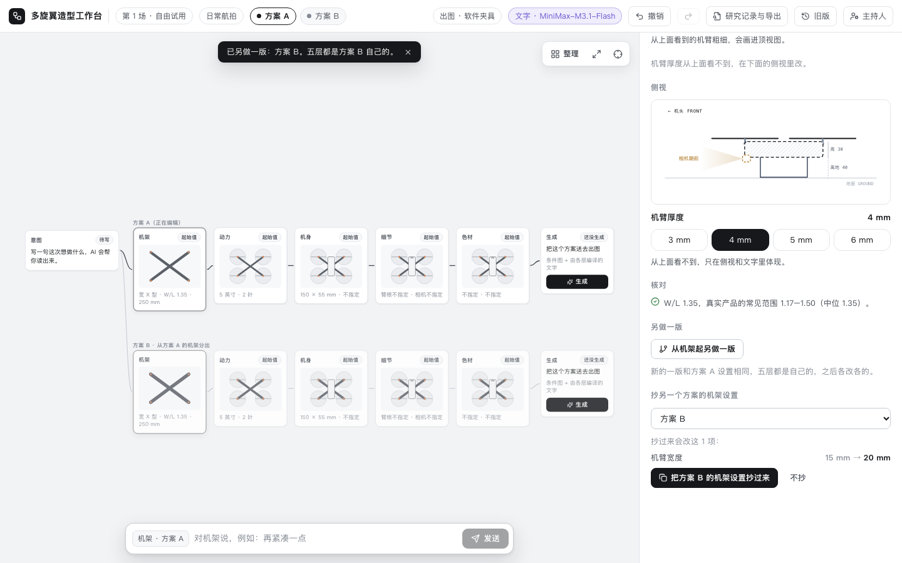
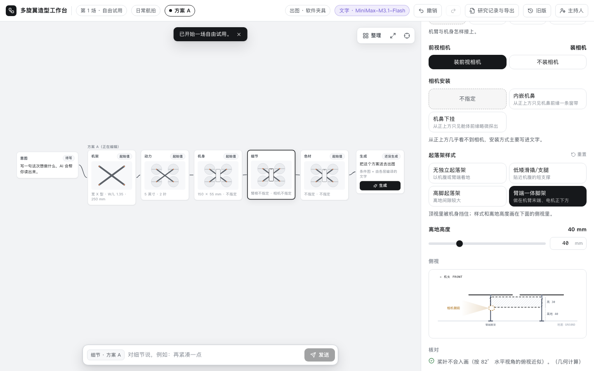
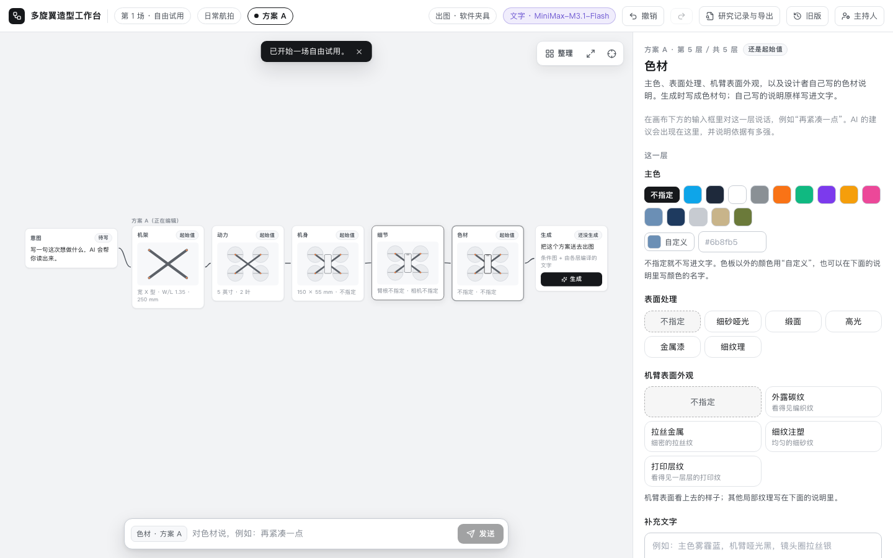
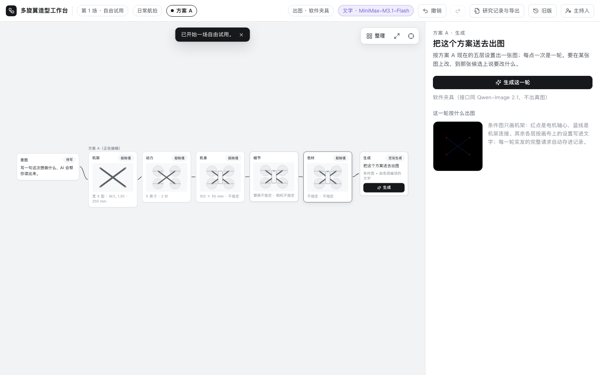

# 工作台 4.4 复核记录（2026-11-24）：作者试用的 11 条，Codex 子代理的 4 条

作者 11 月 24 日试用 4.3.1 以后，认为工作台还没有体现研究的严谨和实验流程，提了 11 条；同时转来 Codex 子代理列出的、正式预试前必须修的 4 条。这一页逐条写：说的是什么，4.3.1 是怎样的，4.4 改成什么，用哪项检查核对。

结论：15 条都在 4.4 里改了，并通过同一套检查。`npm run walkthrough:issues` 新加 R1—R8 八项，连同 4.3 留下的 15 项，共 23 项全部通过。子代理的 4 条，我是读 4.3.1 的代码确认的，没有在浏览器里对 4.3.1 重跑一遍。要真实 GPU 和真实文字模型的部分这次没有验证，见第五节。

## 一、开工前对蓝图

| 写明什么 | 这一步 |
| --- | --- |
| 对应论证链的哪一环 | RQ3 两种方式对照的登记条件，即[登记任务表](../../../../planning/2026-11-17-direction-and-todo.md) C1（登记、任务简报、记录表在场次前定稿）和 C2（作者预试：真实输入、候选、分段时间、人工决定和失败都能复核）。对照的约定是[预试记录约定](../../../../evidence/20261117-research-update/method/paired-pilot.md)的“主持与计时”和 11 月 22 日修订（两组用同一个文字模型），以及 [pilot.md](../../../../planning/research-library/design/pilot.md) 第 2 条（同一个人的两场用不同的委托、不同的方式） |
| 对象范围、人数、参数 | 工作台的界面和场次记录。本轮没有真人场次，也没有真实模型调用（文字由规则回退应答，出图由软件夹具应答）。对照的参数：C2 机架三项（真 X、W/L 1.00、对角轴距 250 mm）；限额 15 分钟、9 次、9 张；计时从开场算；登记场次四项（委托、方式、匿名编号、次序） |
| 交到论文哪一节 | 3.5 节（系统实现与记录）；第 4 章外部设计者一节（场次怎样主持、材料怎样收存）；5.5 节（局限：真机和真实文字模型验收以前的状态） |
| 范围由谁定 | 作者 11 月 24 日的 11 条和转来的 4 条。没有新增测量；登记的测量、限额和场次事件表的列都不变。新记的事件有六种：撤销、重做（以前撤销把事件表一起回退，现在另记一条）；不要 AI 提的方向、送回的问题处理好了（以前只改状态，不记）；参与者点任务卡上的“开始”（`task-start`）；主持人打开面板（`moderator-panel`）。都记在本场事件里（ZIP 里的工作区记录），不进登记的场次事件表 |

## 二、子代理的 4 条（正式预试前必须修）

| 条 | 说的 | 4.3.1 是怎样的（读代码） | 4.4 的修改 | 核对（4.4） |
| --- | --- | --- | --- | --- |
| 1 C2 能被改掉 | 登记以后由程序锁定 C2；任务卡、实际规格、导出三处一致 | 登记场次里仍有“解除锁定”；锁定状态放在可撤销的状态里，撤销能把锁撤掉；委托卡上的“真 X、W/L 1.00、250 mm”是写死的文字，和程序实际锁的值没有联系 | 登记场次里没有解除和重新载入的按钮；锁定不进撤销；机架面板只读，不能从机架另做一版，也不能抄机架。任务卡和委托卡上“固定不变的”几行从登记条件生成（[conditions.ts](../../src/v4/conditions.ts)），机臂宽 15 mm、厚 4 mm 随机架固定，也写出来。导出时逐个方案核对三项，并查本场有没有解除过（清单里的 `session.registrationCondition`、`checks.registeredConditionHolds`），不成立就不算完整的登记场次 | R1：解除按钮 0 个；机臂宽 20 mm 点不了；撤销后仍是 `c2-pilot`；导出核对 `ok: true`，不一致 0 项，登记场次完整 |
| 2 撤销抹掉研究记录 | 撤销改的是方案状态；原事件保留，另记一条撤销；主持人交接和暂停的时长要准 | 撤销恢复整份存档，事件表一起回退：修改事件、技术暂停和恢复都被抹掉，暂停时长随之没了 | 撤销只恢复设计：方案、各层，以及建议和方向的状态。事件、对话、比较、AI 的输出只增不删。撤销和重做各记一条，写明撤的是什么 | R2：改顶盖，记 1.2 秒技术暂停，再撤销。修改、暂停开始、暂停结束三条都在，另有“撤销：顶盖分件 不指定 → 两段”；顶盖回到不指定；ZIP 里暂停 1218 ms |
| 3 同一个人能登记两次第 1 场 | 冲突时不能提交，当前这一场照常继续 | 只提示冲突；点“开始”时先结束当前这一场再开新的 | 冲突时“开始登记场次”是灰的，写明哪一项重了（次序、委托或方式），并写“现在不能开，这一场照常继续”。开场前先查冲突，查过了才结束上一场 | R3：P73 再登记一个第 1 场，按钮点不了；当前这一场没有结束；本机只有一个 P73 第 1 场 |
| 4 两种方式起点不同 | 开场时两种方式看到同一段委托、同一版依据、同样的限额，计时同一个起点；界面提示只说当前这一步怎么做 | 自由提示一开场就是委托卡；工作台开在总览上，要点“去做”才看到委托；自由提示页上有拿工作台作比较的话 | 登记场次开场先盖一张任务卡（[TaskStart.tsx](../../src/v4/ui/TaskStart.tsx)），两种方式用同一个组件：委托原文、要看和要保持的、固定不变的、用户依据摘要、限额。点“开始”记一笔 `task-start`，计时仍从开场算。自由提示页的提示改成只说这一步怎么做 | R4：两边任务卡的文字逐字相同（677 字）；两场都记了“开始”；两场计时的起点都是开场；自由提示页上没有比较的话 |

## 三、作者的 11 条

| 条 | 说的 | 4.3.1 | 4.4 | 核对 |
| --- | --- | --- | --- | --- |
| 1 | “在这里分叉”改名，从中间层开始时说明哪些上游决定仍共用；正式场次机架固定时，入口放在能改的层 | 按钮叫“在这里分叉”“在机架处分叉”；不说哪些层仍共用；机架锁定时机架层也有这个按钮 | 按钮叫“从机身起另做一版”（按所在的层）。按钮下写明“机架、动力仍共用，以后改它们，两个方案一起变”；从机架起另做时写“五层都是自己的”。机架固定时，机架层写“要另做一版，到动力、机身、细节或色材层”，按钮在那几层 | R7 |
| 2 | “应用”改为“把方案 B 的机架设置抄过来”，覆盖前列出会变的项 | 下拉“套用另一条方向的机架…”，选中即覆盖，不列变化 | 先选来源，列出“抄过来会改这 1 项：机臂宽度 15 mm → 20 mm”；点“把方案 B 的机架设置抄过来”才覆盖，也可以“不抄”。两边一样时写“没有要抄的”。事件记“把方案 B 的机架设置抄到方案 A：机臂宽度 15 mm → 20 mm” | R7 |
| 3 | 原始事件在后台自动记，主持人按场次导出；设计者只看有用的反馈；值真的变了才算修改；登记场次的面板上不该出现试用记录 | 层面板下有“这一层的记录”，列原始事件；点已经选中的 15 mm 也记一条修改 | 层面板不再列原始事件，处理过的 AI 建议收进折叠的“处理过的 AI 建议”。值没变不记。修改事件带字段、原值和新值，文字写成“机臂宽度 15 mm → 20 mm”。另做一版、抄设置以后给一句提示，例如“已另做一版：方案 B” | R6：点 15 mm 记 0 条；改成 20 mm 记“机臂宽度 15 mm → 20 mm”；“这一层的记录” 0 处 |
| 4 | 八旋、共轴、GPU 流程的说明移出机架面板，留在迁移协议 | 机架面板有一段“八旋、共轴等其他构型不在工作台里做……” | 删去这段。植保只写“这个任务只有这一种构型”。迁移流程仍在[迁移协议](../../../../planning/advisor-20261118/cross-layout-protocol.md)和[工作台与主线的对齐](../../../../planning/2026-11-23-workbench-alignment.md)里 | R8：这段说明 0 处 |
| 5 | 开场文字：试用入口只列两个任务；登记场次显示分到的任务、委托原文和共同依据 | 意图面板写“先做主实验的日常航拍；植保六旋看药箱、喷洒部件与机架的整合。其他构型不在这里做。” | 任务选择只列“日常航拍四旋”“农业植保六旋”。登记场次写“这一场按委托做日常航拍。”，委托卡和任务卡给出委托原文、固定不变的和用户依据摘要 | R8：任务两项；页面上没有“先做主实验” |
| 6 | 旧版、研究记录与导出、主持人用的东西，正式场次里归主持人；参与者留生成、修改、比较、选候选和必要的反馈；旧版带 B2 案例 | 顶栏有“研究记录与导出”“旧版”；总览面板最下面有“研究场次（主持人用）” | 顶栏加“主持人”。场次设置、逐轮的研究记录、旧版与 B2 案例都在主持人面板里。登记场次里顶栏不显示研究记录、旧版，也不显示出图后端和文字模型的标签。登记场次里打开主持人面板要先确认，打开一次记一笔；开场、换方式、结束本场、载入或解除条件以后面板自己关上 | R5：登记场次顶栏上这三项 0 个，面板里各 1 个；先确认；记了一笔 |
| 7 | 机臂宽度和厚度：试用时宽度可以自定义；厚度移到侧视细节里；正式场次按登记固定 | 宽度 10、15、20 mm 和厚度 3—6 mm 都在机架面板主区 | 试用时宽度多一个自定义（4—80 mm）。厚度移到“侧视”里，和侧视图放在一起。登记场次里两项随机架锁定在 15 mm、4 mm，任务卡上写明 | R8；R1 |
| 8 | 电机倾角在主面板收起，默认 0° | 在动力面板主区 | 收进“更多：电机前倾（现在 0°）”，默认 0°；不是 0° 时自动展开 | R8：默认收起 |
| 9 | 脚架加“臂端一体脚架”，侧视画出安装位置（作者给的依据：Mavic Air 用户手册第 8 页） | 三种：无独立起落架、低矮滑撬/支腿、高脚起落架 | 加“臂端一体脚架”（做在机臂末端、电机正下方）。顶视在电机轴心处画小圈；侧视在电机轴线下画脚架到地面，标“臂端脚架”。请求里写“Short landing legs are built into the underside of each arm tip, directly below each motor…” | R8：选中后侧视出现脚架；实发请求里有这句 |
| 10 | 材料用看得出来的外观名，其他质感写进说明 | “机臂材料外观”：碳纤维、铝合金、ABS 塑料、PLA 塑料 | “机臂表面外观”：外露碳纹（看得见编织纹）、拉丝金属（细密的拉丝纹）、细纹注塑（均匀的细砂纹）、打印层纹（看得见一层层的打印纹）。其他局部纹理写进色材层的补充文字。取值和发给出图模型的英文句子不变，旧项目照样读 | R8 |
| 11 | “这一轮想看什么”和全文：直接按确认的设置生成；局部修改走候选上的“在这张图上改”；完整请求自动存档 | 生成面板有“这一轮想看什么（选填）”、父图下拉和“完整文字” | 生成面板只有“生成这一轮”，以及这一轮按什么出图（条件图和一句说明）。要在某张图上改，到那张候选上说。完整请求照旧进每一轮的记录和本场 ZIP | R8：目标输入、全文、父图下拉都是 0 个 |

另外几处顺带改的：画布上的每一行改叫“方案”（方案 A、方案 B），AI 提的仍叫“方向”；方案名以字母结尾时，后面接中文加一个空格（“方案 B 的”）。登记场次里顶栏不放旧版，主持人从面板上的“旧版与 B2 案例”进。比较页的标题改成“差在 N 项设置”；工作台的轮次另列每张图的父图和修改说明。

## 四、核对

| 核对 | 结果 |
| --- | --- |
| `npm run walkthrough:issues` | 23 项全过。新加 R1—R8（子代理 1—4，作者 6、3、1—2、4—5 和 7—11），4.3 的 15 项照旧通过 |
| `node --test scripts/*.test.mjs` | 54 项通过。新加 4 项：另做一版以后上游仍共用、两个方案某一层的差别、登记条件逐个方案核对、重复登记 |
| `npm run verify` | 71 项通过 |
| `npm run walkthrough:studio4` | 通过（10 场，真实模型调用 0）。场次设置改从主持人面板进，登记场次先过任务卡 |
| `walkthrough:canvas`、`walkthrough:methods`（3.6）、`check-offline` | 通过，没有页面错误 |
| `npm run ai:smoke -- --fixture` | 5 项通过（规则回退） |
| `npm run gpu:acceptance`（夹具演练） | 6 轮全过，没有发现问题。工作台那一场的两次修订改走首图候选上的“在这张图上改”（4.4 起生成面板不再选父图、不再另写目标）；报告里并列写出修改说明和这一轮的目标 |
| 代码检查 | 改动涉及的文件 0 个错误，1 个旧警告（Evidence.tsx，没改过） |
| 离线版与交接清单 | 离线 ZIP 重新打包；交接清单里工作台的 README、package.json、package-lock.json 和离线 ZIP 四项校验值已更新，`verify_checkout.py` 核过 61 个文件 |

真实模型调用 0 次，真人场次 0 场。

## 五、还没验证的，和要作者定的

1. **真机和真实文字模型。** 这次全部用夹具和规则回退。真机验收的跑法同 [4.3 复核记录第五节](../20261123-workbench-4.3/README.md#五真机验收怎么跑)。有一点不同：工作台那一场的两次修订现在走候选上的“在这张图上改”。修改说明先交给文字模型整理成这一轮的目标；用规则回退时，“只改臂根……”这一轮的目标会变成“只改细节，其余保持。”，同时把臂根改成无缝过渡。报告把写的修改说明和这一轮的目标并列写出，读盲读材料时对照着看。正式场次用真实文字模型，目标由模型写。
2. **子代理的 4 条没有在 4.3.1 上重跑。** 我读了 4.3.1 的代码，确认四条都属实，修好以后的检查只在 4.4 上跑过。
3. **植保六旋的机臂宽度预设没有改。** 手头没有六旋实机的臂宽数据，所以没动；试用时可以用自定义宽度。
4. **点“开始”的时间。** 记在本场事件里，不进登记的场次事件表；计时仍从开场算，两组一样，读任务卡的时间算在主动操作里。如果要把读任务卡的时间扣掉，或者列进事件表，那是改登记的口径，由你定。
5. **主持人面板好不好用。** 先确认、开场后自己关上，这一套要在你的预试（C2）里实际用过才知道顺不顺手。场次中途从面板进旧版不会结束这一场；离开工作台的这段时间照常算主动操作，要扣掉就先记“技术暂停”。
6. **用户依据摘要。** 仍是 4.3 的 v0 草稿，等你定稿。

## 截图

在 `npm run walkthrough:issues -- --shots=<目录>` 里截的，软件夹具，不是真图。

| | |
| --- | --- |
|  登记场次开场：两种方式同一张任务卡，固定不变的几行从登记条件生成 |  登记场次的机架层：只读，写明是登记的条件；顶栏写“机架已固定”，没有研究记录和旧版 |
|  登记场次里打开主持人面板先确认，打开会记进这一场 |  主持人面板：计时、交接与暂停、导出、结束、开下一场；重复登记时开始按钮是灰的，写明冲突 |
|  “从机身起另做一版”：写明机架、动力仍共用 |  抄另一个方案的机架设置：先列出会变的一项，确认了才抄；厚度在侧视里 |
|  臂端一体脚架：侧视在电机轴线下画出脚架 |  机臂表面外观按看上去的样子起名 |
|  生成面板：按现在的设置出图；局部修改到候选上说 | |
